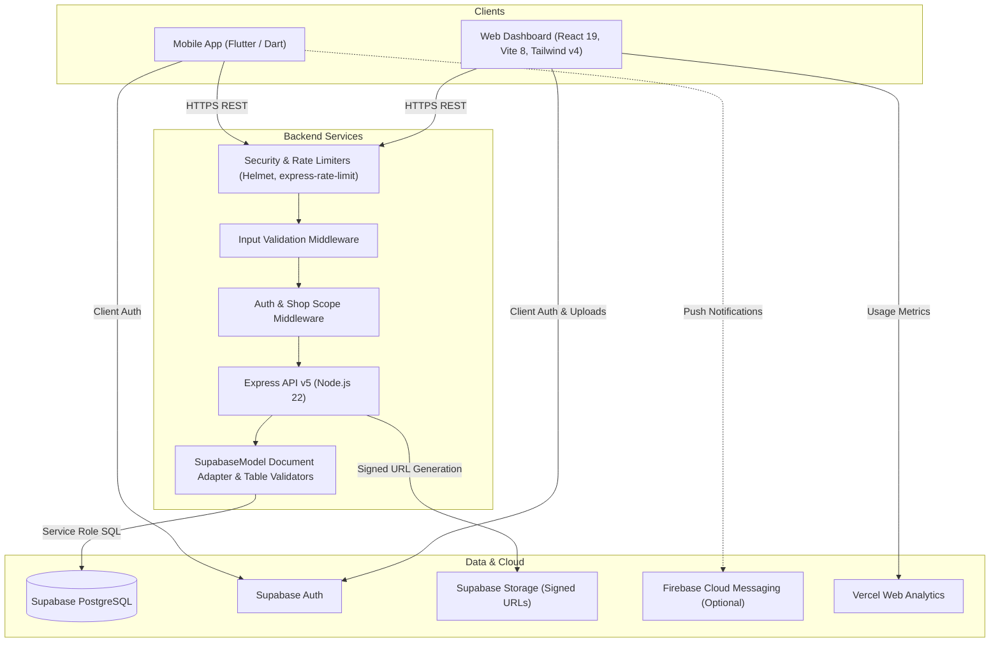
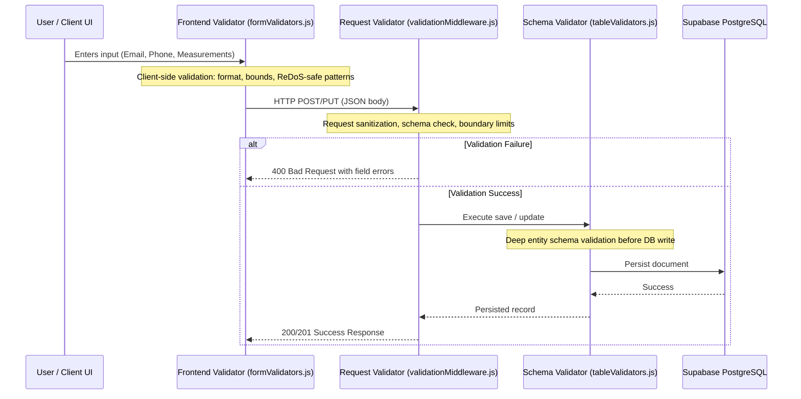

# 🏛️ StitchCraft Architecture

This document describes the high-level architecture, multi-tenant boundaries, security posture, validation layers, data patterns, and testing strategy for StitchCraft.

---

## 1. System Overview

StitchCraft is a full-stack, multi-tenant tailor shop management system designed for Indian masterji shops. The system consists of three primary clients/services:

The Express API is the single source of truth for business rules, calculations, and data mutation. Clients never perform unchecked write operations or duplicate authorization logic.

---

## 2. Multi-Tenant Shop Isolation

StitchCraft is multi-tenant by design. A single user can own or work in multiple shops, but operational data is strictly segregated.

1. **Tenant Identifier (`shopId`)**:
   - Every domain entity (`Order`, `Customer`, `Karigar`, `Machine`, `Inventory`, `Payment`, `Transaction`, `LedgerEntry`, `Delivery`) carries a mandatory `shopId`.
2. **Context Resolution**:
   - The `protect` middleware verifies the incoming Supabase bearer token and resolves the user's active shop ID from their profile context or request header (`X-Shop-Id`).
3. **Query Scoping**:
   - All database reads and writes via `SupabaseModel` automatically scope queries with `.eq('shopId', req.shopId)` to prevent cross-tenant data leaks.
4. **Isolated Resource Access**:
   - Cross-shop boundary checks are verified by automated tests (`shop_isolation.test.js`), ensuring users cannot read or mutate data belonging to other tailor shops.

---

## 3. End-to-End Validation Layer

Data validity is enforced across three distinct tiers:

### Tier 1: Client-Side Form Validation (`stitchcraft-frontend/src/utils/formValidators.js`)
- Instant feedback before form submission.
- Enforces RFC 5321 length limits (`<= 254` characters) and linear-time regexes for emails.
- Validates Indian 10-digit phone numbers, required fields, and numeric measurement bounds.

### Tier 2: Route & Request Validation Middleware (`stitchcraft-backend/middleware/validationMiddleware.js`)
- Intercepts requests before reaching controllers.
- Validates request body structure, allowed enums, numeric ranges, and date formats.
- Prevents malformed or malicious payloads from triggering unexpected server exceptions.

### Tier 3: Database & Schema Validation (`stitchcraft-backend/utils/tableValidators.js`)
- Runs within `SupabaseModel` lifecycle hooks before insert/update.
- Validates required fields, data types, and relational constraints across all models.

---

## 4. Security Architecture

### Security Headers
- Protected via `helmet` with custom cross-origin resource policies for media access.

### Multi-Tier Rate Limiting (`express-rate-limit`)
- **API Limiter**: 300 requests / 15 minutes per IP across all `/api` routes.
- **Auth Limiter**: 10 requests / 15 minutes per IP on `/api/auth/login` and `/api/auth/register`.
- **Upload Limiter**: 30 requests / 15 minutes per IP on `/api/upload`.
- **Destructive Actions Limiter**: 10 requests / 15 minutes per IP on sensitive operations (account deletion, database imports).

### ReDoS & Injection Hardening
- All regular expressions in backend middleware and frontend validators are bounded and linear (deterministic, non-backtracking).
- Zero open alerts in GitHub CodeQL across code scanning, Dependabot, and secret scanning.

### Token Security & Sensitive Data Handling
- Supabase Auth tokens are managed through managed session lifecycles without exposing raw credentials in client storage.

---

## 5. Key Business & Data Patterns

### Immutable Payment Ledger
Payments are **never updated directly**.
- Every payment or refund produces an immutable `Transaction` record.
- `syncPaymentFromTransactions()` aggregates all transactions to calculate `paidAmount`, `balanceAmount`, and payment `status` (`Pending`, `Partial`, `Paid`).

### Measurement Snapshotting
- When creating an order, the customer's current measurements are snapshotted into `order.measurementsSnapshot`.
- Future customer measurement changes do not retroactively alter completed or in-progress orders.

### Inventory & Lining (Aster) Deductions
- When an order transitions to production (`Cutting` or `Stitching`), required astar/fabric quantities are deducted from active inventory records.

---

## 6. Testing & Quality Assurance

StitchCraft maintains automated test suites across all three modules:

### Backend (`node --test`)
- **`order_lifecycle.test.js`**: Order creation math, aster deductions, status progressions, and payment calculations.
- **`ledger_and_expenses.test.js`**: Khata ledger entry aggregation, balance calculation, and category reporting.
- **`security_and_scoping.test.js`**: Role authorization, rate-limiting handlers, ReDoS bounds, and identifier validation.
- **`shop_isolation.test.js`**: Cross-tenant data isolation and multi-shop boundary controls.

### Frontend (`node --test`)
- **`form_validators.test.js`**: Form validation rules, regex edge cases, and boundary checks.
- **`formatters.test.js`**: Currency (INR) and date formatting helpers.

### Mobile (`flutter test`)
- **`unit_test.dart`**: App theme, colors, and configuration unit tests.
- **`widget_test.dart`**: Widget interaction and UI component rendering tests.

---

## 7. Deployment Architecture

| Service | Hosting Platform | Config File | Notes |
|---|---|---|---|
| Backend API | Render Web Service | `render.yaml` | Node.js 22, connects to Supabase via service role |
| Web Dashboard | Vercel | `vercel.json` | Vite SPA build with client-side routing rewrites |
| Database & Storage | Supabase | `supabase/migrations/` | PostgreSQL with relational tables & signed storage |
| Mobile App | Android / iOS | `pubspec.yaml` | Release APK / AppBundle |
