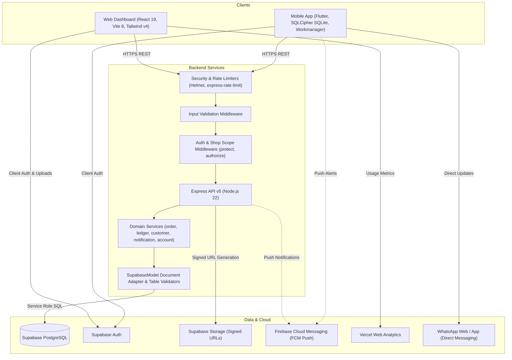
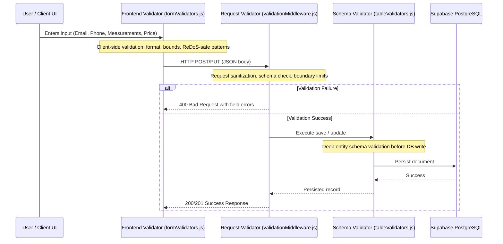

# 🏛️ StitchCraft Architecture

This document describes the high-level architecture, multi-tenant boundaries, security posture, validation layers, data patterns, and testing strategy for StitchCraft.

---

## 1. System Overview

StitchCraft is a full-stack, multi-tenant tailor shop management system designed for Indian masterji shops and boutiques. The platform unites a responsive web dashboard, a native mobile application, and a hardened Express API backed by Supabase PostgreSQL.

The Express API is the single source of truth for business rules, calculations, and data mutation. Clients never perform unchecked write operations or duplicate authorization logic.

---

## 2. Multi-Tenant Shop Isolation & Role-Based Access Control

StitchCraft is multi-tenant by design. A single user profile can own or associate with multiple tailor shops, but operational data is strictly partitioned.

1. **Tenant Identifier (`shopId`)**:
   - Every domain entity (`Order`, `Customer`, `Karigar`, `Machine`, `Inventory`, `Payment`, `Transaction`, `LedgerEntry`, `Delivery`, `Notification`) carries a mandatory `shopId`.
2. **Context Resolution**:
   - The `protect` middleware verifies the incoming Supabase bearer token and attaches the authenticated user record (`req.user`) including their active `shopId` and shop-specific role.
   - Users can switch their active branch context at any time via `PUT /api/auth/switch-shop/:id`.
3. **Query Scoping**:
   - All controller queries and service functions scope database operations using `{ shopId: req.user.shopId }`.
   - `SupabaseModel` filters data sets and prevents cross-tenant records from being queried or mutated.
4. **Isolated Resource Access**:
   - Cross-shop boundary checks are verified by automated tests (`shop_isolation.test.js`), ensuring users cannot read or mutate data belonging to other tailor shops even if an entity's primary ID is known.

### Role Authorization & Capabilities Matrix

StitchCraft defines four explicit user roles per shop branch:

| Capability | Owner | Manager | Staff | Karigar |
|---|:---:|:---:|:---:|:---:|
| View Dashboard & Analytics | ✅ | ✅ | ❌ | ❌ |
| Order Creation & Lifecycle | ✅ | ✅ | ✅ (Assigned) | ✅ (Status only) |
| Customer Profiles & Measurements | ✅ | ✅ | ✅ | ❌ |
| Khata Ledger & Udhar Recovery | ✅ | ✅ | ❌ | ❌ |
| Shop Expenses Management | ✅ | ✅ (Read/Create) | ❌ | ❌ |
| Inventory & Lining (Aster) Stock | ✅ | ✅ | ✅ (Read) | ❌ |
| Karigar & Machine Registry | ✅ | ✅ | ❌ | ❌ |
| Staff Invitation & Role Delegation | ✅ | ❌ | ❌ | ❌ |
| Shop Settings (UPI, GST, Logo) | ✅ | ❌ | ❌ | ❌ |
| Data Export / Import / Wiping | ✅ | ❌ | ❌ | ❌ |
| Account Deletion | ✅ | ❌ | ❌ | ❌ |

- **Staff Management (`/api/staff`)**: Mounted at `/api/staff`, allowing shop owners to list, invite, update roles (`owner`, `manager`, `staff`, `karigar`), toggle active status, and unlink members. Managers can view staff but cannot modify roles. Standard staff and karigars are blocked with HTTP 403.
- **Role Enforcement Status**: While the 4-role matrix (`owner`, `manager`, `staff`, `karigar`) is architecturally defined and verified by unit tests, `authMiddleware.js` currently enforces owner privileges on sensitive mutation endpoints, pending persistent multi-role assignment rollout in the database layer.

---

## 3. End-to-End Validation Layer

Data validity is enforced across three distinct tiers:

### Tier 1: Client-Side Form Validation (`stitchcraft-frontend/src/utils/formValidators.js`)
- Instant feedback before form submission.
- Enforces RFC 5321 length limits (`<= 254` characters) and linear-time regexes for emails.
- Validates Indian and international phone numbers (10 to 15 digits), required fields, positive currency values, and numeric measurement bounds.

### Tier 2: Route & Request Validation Middleware (`stitchcraft-backend/middleware/validationMiddleware.js`)
- Intercepts requests before reaching controllers.
- Validates request body structure, allowed enums (`status`, `itemType`, `specialization`), numeric ranges, and date formats.
- Prevents malformed or malicious payloads from triggering unexpected server exceptions.

### Tier 3: Database & Schema Validation (`stitchcraft-backend/utils/tableValidators.js`)
- Runs within `SupabaseModel` lifecycle hooks before insert/update across 13 entity tables.
- Validates required fields, data types, and relational constraints across all models.

---

## 4. Security Architecture

### Security Headers
- Protected via `helmet` with custom cross-origin resource policies for media access.

### Multi-Tier Rate Limiting (`express-rate-limit`)
- **API Limiter**: 300 requests / 15 minutes per IP across all `/api` routes.
- **Auth & Password Recovery Limiter**: 10 requests / 15 minutes per IP on `/api/auth/login`, `/api/auth/register`, `/api/auth/verify`, `/api/auth/forgot-password`, and `/api/auth/reset-password`.
- **Upload Limiter**: 30 requests / 15 minutes per IP on `/api/upload/*`.
- **Destructive Actions Limiter**: 10 requests / 15 minutes per IP on sensitive operations (account deletion, database exports/imports, password updates, and **all HTTP `DELETE` requests** across `/api`).

### Role-Based Authorization (`authorize`)
- Strict multi-role checking (`owner`, `manager`, `karigar`, `staff`).
- Destructive operations (account deletion, database wiping, expense deletion, shop deletion) and administrative staff delegation strictly require the `owner` role.
- Managers are permitted day-to-day workshop coordination (orders, customers, inventory, khata, viewing staff) without access to destructive or owner-only settings.

### Public Receipt & Tokenized Invoice Sanitization
- Public client invoices accessible via `/api/orders/public/:token` (or order ID fallback) strictly sanitize all internal workshop data before rendering.
- Strips internal profit margins, wholesale fabric costs, assigned karigar IDs, and internal audit notes.
- Generates dynamic UPI payment QR codes using the shop's configured `upiId` (VPA) for instant client settlement.
- Expired or revoked share tokens cleanly display an invalid/expired state without leaking information.

### Password Recovery Security
- Implements secure, time-bounded crypto reset tokens with automatic invalidation upon successful reset.
- Rate-limited to prevent brute-force attacks, with server-side validation enforcing a minimum of 6 characters and strict email format checks.

### ReDoS & Injection Hardening
- All regular expressions in backend middleware and frontend validators are bounded and linear (deterministic, non-backtracking).
- Zero open alerts in GitHub CodeQL across code scanning, Dependabot, and secret scanning.

### Token Security & Sensitive Data Handling
- Supabase Auth tokens are managed through managed session lifecycles without exposing raw credentials in client storage.
- Local mobile SQLite databases are encrypted at rest using AES via `sqflite_sqlcipher`.

---

## 5. Key Business & Data Patterns

### Immutable Payment Ledger
Payments are **never updated directly**.
- Every payment or refund produces an immutable `Transaction` record.
- `syncPaymentFromTransactions()` aggregates all transactions to calculate `paidAmount`, `balanceAmount`, and payment `status` (`Pending`, `Partial`, `Paid`).

### Udhar & Pending Balances Aggregation
- Outstanding customer balances are computed on demand across all unpaid or partially paid orders via `/api/customers/pending-balances`.
- Generates pre-formatted WhatsApp payment reminder messages containing customer name, shop details, total due, and payment prompts for one-tap dispatch.

### Shop Branding & Invoice Customization
- Shop owners can configure custom invoice prefixes (e.g., `INV`, `SC`), GSTIN identification numbers, shop logo URLs, and UPI IDs (VPAs).
- Invoices dynamically compute invoice numbers using the configured prefix and render the shop logo and UPI QR code.

### Measurement Snapshotting
- When creating an order, the customer's current measurements are snapshotted into `order.measurementsSnapshot`.
- Future customer measurement changes do not retroactively alter completed or in-progress orders.

### Inventory & Lining (Aster) Deductions
- When an order transitions into active workshop stages defined by `ASTAR_DEDUCT_STATUSES` (`['Stitching', 'Checking', 'Ready', 'Delivered']`), required astar/fabric quantities are deducted from active inventory records.
- Cancelling an order automatically restores the deducted inventory quantity.

### Offline-First Mobile Architecture & Sync Monitor
- Mobile app persists data locally in an encrypted SQLite database (`LocalDatabaseService` using `sqflite_sqlcipher`).
- Mobile screens perform direct reads and writes to local SQLite, ensuring zero UI latency and offline operation.
- `SyncWorker` powered by `workmanager` runs background synchronization every 15 minutes via `SyncService().syncAll()` to reconcile customers, orders, expenses, and inventory with the REST API.
- `SyncStatusScreen` provides visibility into the offline queue (pending orders, customers, inventory), last sync timestamps, and a manual "Sync Now" trigger with retry logic.

### Customer WhatsApp Integration
- `WhatsAppService` generates direct WhatsApp messaging links (`https://wa.me/`) with pre-composed order updates for booking, trial ready, delivery notices, and pending balance (udhar) reminders.

### Full Tri-Lingual Internationalization (i18n)
- Native localization in **English (`en`)**, **Gujarati (`gu`)**, and **Hindi (`hi`)**.
- **Web Frontend**: Managed via `LanguageContext` and `translations.js` with 558 synchronized translation keys loaded from locale JSONs. Real-time language switching in the top bar.
- **Mobile App**: Managed via Flutter ARB files (`app_en.arb`, `app_gu.arb`, `app_hi.arb`) and synchronized `AppLocalizations` delegates with 183 translation keys across all 3 languages.

---

## 6. Testing & Quality Assurance

StitchCraft maintains automated test suites across all three modules:

### Backend (`node --test`) — 57 Automated Tests Across 18 Suites
- **`financial_integrity.test.js`**: Payment idempotency, duplicate transaction prevention, immutable refund records, and credit delivery checks.
- **`idempotency_and_inventory.test.js`**: Order and customer idempotency keys, single-fire aster stock deduction/restoration, Indian currency formatting, and inventory adjustments.
- **`ledger_and_expenses.test.js`**: Khata financial summaries, running cash book balance, and category reporting.
- **`order_lifecycle.test.js`**: Order creation math, aster deductions, status progressions, note appending, and payment transitions.
- **`pending_balances.test.js`**: Udhar calculation math across orders and pre-filled WhatsApp reminder generation.
- **`public_invoice_hardening.test.js`**: Opaque share token validation, payload sanitization (phone/address/cost stripping), 410 on revoked/expired links, and rate limiting.
- **`security_and_scoping.test.js`**: Role authorization, rate-limiting handlers, ReDoS bounds, public receipt sanitization, partner outsource privacy, notification dispatch fallbacks, and identifier validation.
- **`shop_isolation.test.js`**: Cross-tenant data isolation, identifier leakage prevention, and multi-shop boundary controls.
- **`staff_management.test.js`**: Multi-role authorization policies, owner vs manager privileges, role updates, and member unlinking.

### Frontend (`node --test`) — 18 Automated Tests Across 11 Suites
- **`form_validators.test.js`**: Form validation rules, regex edge cases, required fields, and boundary checks.
- **`formatters.test.js`**: Currency (₹ INR) and date formatting helpers.

### Mobile (`flutter test`)
- **`unit_test.dart`**: App theme, color palettes, and configuration unit tests.
- **`widget_test.dart`**: Widget interaction and UI component rendering tests.

---

## 7. Deployment Architecture

| Service | Hosting Platform | Config File | Notes |
|---|---|---|---|
| Backend API | Render Web Service | `render.yaml` | Node.js 22, connects to Supabase via service role |
| Web Dashboard | Vercel | `vercel.json` | Vite SPA build command and `dist` output configuration |
| Database & Storage | Supabase | `supabase/migrations/` | PostgreSQL with relational tables & signed storage |
| Mobile App | Android / iOS | `pubspec.yaml` | Release APK / AppBundle |
