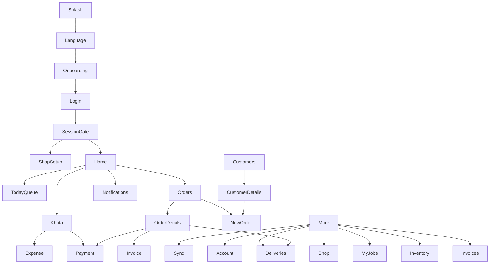

# StitchCraft Mobile UX Improvement Plan

## 1. Design principles

1. **One-handed counter operation:** primary action at the bottom, one dominant
   action per screen, targets at least 48dp, no essential action hidden in a
   top-right overflow.
2. **Fast path first:** save a usable order in under two minutes; optional
   photos, assignments and notes come after the minimum viable record.
3. **Local language first:** use English, Hindi and Gujarati keys for every
   visible string; preserve familiar terms such as udhar, khata, astar, karigar
   and maap consistently.
4. **Minimum typing:** reuse customers and measurements, import contacts,
   numeric keyboards, chips and voice input with clear fallback.
5. **Offline trust:** show saved locally/synced/failed states at screen and
   record level; never imply cloud confirmation when only local save occurred.
6. **Action over analytics:** Home answers “what must I do now?” before showing
   charts.
7. **Role clarity:** owner/manager manage the shop; staff execute assigned
   work; karigar sees My Jobs, not an administrative directory.
8. **Status is redundant:** combine text, icon, shape and position; never rely
   on color alone.
9. **Calm destructive UX:** isolate danger actions, explain consequences,
   require confirmation, and offer undo where feasible.

## 2. Proposed information architecture

### Bottom navigation

`Home` | `Orders` | `Customers` | `Khata` | `More`, with a centered
`New order` button. Keep this structure from the wireframe, but make `More`
role-aware and reduce its contents.

### Screen map



### More grouping

* **Workshop:** Inventory, My Jobs (karigar) or Team (owner/manager), Machines,
  Repairs only if production-ready.
* **Money:** Deliveries, Invoices, Payments/Khata.
* **Shop:** Shop settings, notifications, sync.
* **Account:** Profile, language, theme, logout.
* **Danger zone:** separate owner-only screen.

## 3. Design-system work

### DS-01 — Establish tokens for all three themes

Create semantic tokens for primary action, success, warning, danger, pending,
surface, elevated surface, divider, focus and disabled states. Remove direct
`Colors.white`, `Colors.white10`, fixed dark-card backgrounds and feature-level
color literals. Verify WCAG 4.5:1 for body text and 3:1 for large text/icons.

### DS-02 — Define type, spacing and shape scale

Use an 8dp spacing base, 48dp minimum controls, 56dp primary buttons, 16dp
body text minimum, and text styles that remain usable at 200% scale. Define
compact list, form, summary-card and destructive-dialog primitives.

### DS-03 — Componentize state and action patterns

Adopt shared `LoadingView`, `EmptyStateView`, `ErrorStateView` and
`OfflineBanner` everywhere. Add:

* `PendingChip` with text “Saved on this phone”;
* `PrimaryNextAction`;
* `StatusBadge` with icon + text;
* `MoneyAmount` using Indian grouping;
* `ConfirmDangerDialog`;
* `RetryableActionButton`;
* `SectionHeader` with localized copy.

### DS-04 — Accessibility foundation

Add semantics labels to icon-only controls, replace tap-only
`GestureDetector`s with semantic buttons, preserve focus order, use correct
keyboard/autofill hints, and test text scale 1.0/1.5/2.0.

## 4. Screen-by-screen redesign specifications

### First run

```text
+---------------------------+
| StitchCraft               |
| Choose language           |
| [ English ]               |
| [ हिंदी ]                 |
| [ ગુજરાતી ]               |
|                           |
| [ Continue ]              |
+---------------------------+
```

* **Primary action:** Continue.
* **States:** loading during session restore; offline-safe language choice;
  invalid login with inline field errors; shop setup empty/error/retry;
  role-restricted account state.
* **Copy keys:** `choose_language` / `भाषा चुनें` / `ભાષા પસંદ કરો`;
  `continue` / `जारी रखें` / `ચાલુ રાખો`; `assigned_role` /
  `भूमिका दी गई है` / `ભૂમિકા સોંપાયેલ છે`.
* **Accessibility:** language choices are radios with selected state; no
  carousel required for returning/invited users.

### Home

```text
+---------------------------+
| Good morning, Masterji 🔔 |
| [Saved on phone • Sync]   |
|                           |
| TODAY                     |
| [Due 3] [Late 2]          |
| [Collect ₹12,500]         |
|                           |
| [Start new order]         |
|                           |
| NEXT UP                   |
| Order card + next action  |
+---------------------------+
```

* **Primary action:** Start new order or first urgent task.
* **States:** skeleton; empty “No work due today”; offline banner with pending
  count; retryable dashboard error; permission-restricted analytics for staff.
* **Copy keys:** `today`, `due_today`, `late_orders`, `collect_money`,
  `start_new_order`, `next_up`.
* **Accessibility:** priority cards have text/icon/number, not color only; each
  card is a single 48dp+ target.

### Orders list

```text
+---------------------------+
| Orders                 [+]|
| [Search customer/order]   |
| [Today] [Late] [Ready]    |
| [Unpaid] [All stages ▾]   |
|                           |
| Customer  Garment         |
| Due time  ₹amount  Ready  |
| [Open]                    |
+---------------------------+
```

* **Primary action:** Open the most urgent order; New order remains visible.
* **States:** skeleton; empty with New order; error + retry; offline list with
  local marker; role-restricted edit controls.
* **Copy keys:** `search_orders`, `today`, `late`, `ready`, `unpaid`,
  `all_stages`, `no_orders_found`, `create_first_order`.
* **Accessibility:** replace ten always-visible chips with a filter sheet and
  screen-reader labels; preserve visible stage text.

### New order wizard

```text
+---------------------------+
| New order       Step 1/4  |
| Customer: [Find existing] |
| [Use last measurements]   |
| Garment: [Shirt]          |
|                           |
| [Save draft] [Continue]   |
+---------------------------+
```

Recommended four-step fast path:

1. Customer + garment (allow walk-in).
2. Measurements (reuse previous or sample photo).
3. Material/assignment (optional defaults clearly labeled).
4. Price, advance, due date, review and **Save order**.

* **Primary action:** Continue until final Save order; after save show receipt
  and “Record payment” if advance > 0.
* **States:** draft autosave/resume; offline saved draft; duplicate customer
  suggestion; invalid measurement inline; unavailable inventory with a safe
  “continue without astar” option.
* **Copy keys:** `find_customer`, `walk_in_customer`, `reuse_measurements`,
  `add_garment`, `save_draft`, `resume_draft`, `advance_received`,
  `view_receipt`.
* **Accessibility:** numeric keypad for measurements/prices, explicit unit
  labels, focus moves to first invalid field, progress announced.

### Order details

```text
+---------------------------+
| < Order #123              |
| Ramesh • Shirt   READY    |
| Due today • Balance ₹800  |
|                           |
| [Mark Delivered]          |
| [Record payment]          |
| Call  WhatsApp  Invoice   |
|                           |
| Incoming > Measuring >    |
| Cutting > Stitching > ... |
+---------------------------+
```

* **Primary action:** `Move to [next stage]`; at Ready, `Mark delivered`.
* **States:** local-pending chip; server refresh/retry; empty/missing order;
  permission-restricted action; unpaid delivery confirmation with amount.
* **Copy keys:** `move_to_stage`, `mark_delivered`, `record_payment`,
  `outstanding_balance`, `deliver_unpaid_warning`, `call_customer`.
* **Accessibility:** stepper announces current/complete stages; actions use
  labels, not only icons; destructive delete is isolated in a menu.

### Customers

```text
+---------------------------+
| Customers              [+]|
| [Search name or phone]    |
|                           |
| Ramesh   3 orders         |
| ₹800 due   Last: 12 Oct   |
| [New order]               |
+---------------------------+
```

* **Primary action:** New order for selected customer; Add customer is secondary.
* **States:** empty with Add customer/import contacts; offline/local marker;
  duplicate-phone confirmation; error + retry.
* **Copy keys:** `search_customers`, `new_order_for_customer`,
  `import_contacts`, `no_customers_action`.
* **Accessibility:** phone is exposed as text plus Call action; list rows have
  one logical focus target.

### Customer details

```text
+---------------------------+
| Ramesh             [Call] |
| 3 orders • ₹800 due       |
| [New order with Ramesh]   |
|                           |
| Orders | Measurements     |
| Last order / reuse button |
+---------------------------+
```

* **Primary action:** New order with saved measurements.
* **States:** local-only profile; missing measurements; no orders; retryable
  remote load; permission-restricted edit.
* **Copy keys:** `customer_summary`, `new_order_with_customer`,
  `reuse_last_measurements`, `no_measurements`.
* **Accessibility:** tabs have selected semantics; balance is announced with
  currency and due status.

### Khata/Udhar

```text
+---------------------------+
| Khata                     |
| [Udhar] Income Expenses   |
| ₹12,500 to collect        |
|                           |
| Ramesh  Order #123        |
| Due ₹800                  |
| [Record payment] [WhatsApp]|
|                           |
|                         [+]|
+---------------------------+
```

* **Primary action:** Record payment on each owing customer.
* **States:** loading; no balances with New order; offline pending payment;
  retryable ledger error; owner-only expense deletion confirmation.
* **Copy keys:** `record_payment`, `send_whatsapp_reminder`, `no_udhar_balances`,
  `add_expense`, `amount_due`.
* **Accessibility:** amount is not color-only; FAB label changes by tab or is
  replaced by a bottom action bar.

### Deliveries

```text
+---------------------------+
| Deliver today             |
| [Today] [Late] [Unpaid]   |
|                           |
| Ramesh • Shirt            |
| Ready • Due 4:00 PM       |
| Balance ₹800              |
| [Record payment] [Deliver]|
+---------------------------+
```

* **Primary action:** Deliver after showing balance.
* **States:** no deliveries; offline queue; retry; permission-restricted
  delivery; explicit unpaid confirmation.
* **Copy keys:** `deliver_today`, `ready_for_pickup`, `deliver_order`,
  `balance_due_before_delivery`.
* **Accessibility:** due time and balance are text; late icon has label.

### Profile and settings

```text
+---------------------------+
| Settings                  |
| My profile                |
| Shop settings             |
| Language & theme          |
| Sync & offline data       |
| Notifications             |
|                           |
| Danger zone               |
| Delete shop / account     |
| [Log out]                 |
+---------------------------+
```

* **Primary action:** none; each row is a clear destination.
* **States:** profile loading/error; permission-restricted shop settings;
  unsaved-form warning; destructive confirmation and post-action recovery.
* **Copy keys:** `my_profile`, `shop_settings`, `language_and_theme`,
  `sync_offline_status`, `danger_zone`, `log_out`.
* **Accessibility:** danger section visually and semantically separated;
  owner-only items absent for other roles.

### Karigar “My jobs”

```text
+---------------------------+
| My jobs                   |
| [Today] [All]             |
|                           |
| Shirt • Ramesh            |
| Stitching • Due today     |
| [Open job] [Mark ready]   |
+---------------------------+
```

* **Primary action:** Open assigned job, then Mark ready/next permitted stage.
* **States:** no assigned jobs; offline pending stage; retry; permission
  restriction for unassigned order; success feedback after stage update.
* **Copy keys:** `my_jobs`, `assigned_to_me`, `mark_ready`, `no_assigned_jobs`.
* **Accessibility:** avoid administrative terms; stage changes include spoken
  confirmation and undo where safe.

## 5. Task backlog

| ID | Title | Affected files | Problem / change | Acceptance criteria | Test | Effort | Priority | Dependencies | Backend? |
|---|---|---|---|---|---|---|---|---|---|
| UX-01 | Fix analyzer blockers before UX validation | `core/repositories/*`, `device_contacts_service.dart`, `dashboard_screen.dart` | Current 26 analyzer issues include build errors. Fix undefined methods/fields, duplicate dispose and lifecycle warnings. | `flutter analyze` has no errors; app builds. | Analyzer CI + smoke navigation test | S | P0 | None | No |
| UX-02 | Add localized counter-first shell | `main_navigation_container.dart`, `custom_app_bar.dart`, ARB files | Six competing bottom actions and hardcoded nav labels. Keep five destinations, enlarge labels and expose sync status. | Orders, Customers, Khata one tap; 200% scale has no clipping. | Golden tests at 1x/2x for all locales | M | P0 | UX-01 | No |
| UX-03 | Make Home a Today queue | `dashboard_screen.dart`, `order_list_screen.dart` | Due/Late cards land on same generic list; chart dominates. | Each card opens matching filter; urgent queue appears before chart. | Widget navigation/filter tests | M | P0 | UX-02 | No |
| UX-04 | Redesign order fast path with draft/resume | `create_order/step1_garment.dart` through `step5_details.dart` | Too many decisions and no proven draft/resume/reuse flow. | Existing customer + previous measurements can save an order in four steps; interrupted draft resumes. | Wizard widget + restart integration tests | L | P0 | UX-01 | Possibly |
| UX-05 | Make next-stage action primary | `order_details_screen.dart`, status widgets | Popup status menu hides next action. | One primary next-stage button; stage text/stepper and role restrictions are clear. | Widget tests for every stage/role | M | P1 | UX-02 | No |
| UX-06 | Create delivery queue | `main.dart`, new delivery UI under orders, order details | Deliveries are a completed-order filter. | Ready/due/unpaid queue has Deliver, Payment and confirmation actions. | Widget + integration delivery tests | M | P1 | UX-05 | Yes if policy enforced server-side |
| UX-07 | Make Udhar collection-first | `khata_screen.dart`, `udhar_list.dart`, payment widgets | Reminder is more prominent than payment; FAB meaning is ambiguous. | Record payment is first action; amounts use Indian grouping; tab actions are contextual. | Widget tests for tabs, payment and empty state | M | P1 | UX-03 | No |
| UX-08 | Add repeat-customer measurement shortcut | `customer_details_screen.dart`, wizard, measurement screen | Repeat orders require re-entering/re-finding data. | One tap starts order with last measurements and clear edit option. | Widget/integration repeat-order test | M | P1 | UX-04 | No |
| UX-09 | Add karigar My Jobs | `main.dart`, `more_hub_screen.dart`, new karigar feature screens | Karigar sees registry-oriented UX, not assigned work. | Karigar lands on assigned jobs; owner/manager retain team management. | Role matrix widget tests | L | P1 | UX-05 | Yes if assigned-job query is missing |
| UX-10 | Standardize state and pending feedback | `state_views.dart`, all list/detail screens, `custom_app_bar.dart` | Loading/error/offline states are inconsistent; local-pending is not record-visible. | Every screen has loading/empty/error/retry; records show Saved locally/Synced/Failed. | Golden state matrix | M | P1 | UX-01 | No |
| UX-11 | Localize all visible copy | Feature screens, `app_*.arb`, generated localization | ARB keys match but many UI strings bypass localization. | No user-facing hardcoded English in supported flows; terminology glossary approved. | Locale widget tests and string scan | L | P1 | UX-02 | No |
| UX-12 | Build measurement input system | `step3_measurements.dart`, `voice_text_field.dart` | No diagrams/bounds; mic is not an accessible button. | Garment diagram, unit labels, bounds, fraction keypad, voice permission/error copy. | Widget tests + device voice test | M | P1 | UX-04 | No |
| UX-13 | Separate settings and danger zone | `profile_screen.dart`, `shop_settings_screen.dart`, profile widgets | Too many tabs and risky actions near routine settings. | Profile, shop, preferences, sync and danger are separate; owner-only actions hidden. | Navigation/role/destructive dialog tests | M | P1 | UX-01 | No |
| UX-14 | Theme-token and contrast pass | `core/theme`, feature screens, shared widgets | Direct colors/fixed dark surfaces bypass themes. | All three themes pass contrast and visual review; status is not color-only. | Goldens + contrast script | M | P2 | UX-11 | No |
| UX-15 | Fast inventory and stock adjustment UI | `inventory_screen.dart`, inventory details | Bottom-sheet form is not optimized for counter stock changes. | One-tap +/- adjustment, clear unit, low-stock queue and undo. | Widget tests for units/adjustment | M | P2 | UX-10 | No |
| UX-16 | Actionable notifications | `notification_service.dart`, notifications screen, routing | Taps only log and do not deep-link. | Order/customer payload opens target; invalid payload opens notifications. | Payload unit + integration tests | M | P2 | UX-01 | Possibly |
| UX-17 | Label repairs/gallery prototype status | `repair_dashboard.dart`, gallery routes | Prototype surfaces look production-ready. | Either hidden behind feature flag or labeled with supported/offline limitations. | Widget visibility test | S | P2 | UX-13 | No |
| UX-18 | Image/performance resilience | Order/material/invoice screens, shared image widget | Image loading and large-list performance are unverified. | Placeholders, retry, caching and 1,000-row scroll remain responsive. | Performance integration test | M | P2 | UX-10 | Possibly pagination |
| UX-19 | Password/PIN protection for shared phones | Profile/settings and auth gate | Shared counter devices may expose business data after unlock. | Product-approved timeout/PIN/biometric flow protects sensitive screens without blocking offline work. | Integration security UX tests | L | P3 | UX-13 | No |
| UX-20 | Multiple garments and customer-facing receipt | Wizard, invoice details/PDF | Common tailor workflow and advance handoff are not evidenced. | One order supports garments; receipt can be shown/shared immediately after save. | Integration/PDF tests | L | P3 | UX-04 | Yes for multi-item order contract |

## 6. Milestones

### Milestone 1 — Ship-safe foundations

Merge UX-01, UX-02 and UX-10. Fix analyzer blockers, stabilize shell labels,
and make state/pending feedback consistent.

### Milestone 2 — Daily counter speed

Merge UX-03, UX-04, UX-07 and UX-08. Optimize Home, order creation, Udhar and
repeat customers; these are the highest-frequency owner tasks.

### Milestone 3 — Workshop execution

Merge UX-05, UX-06 and UX-09. Make next-stage work, deliveries and karigar jobs
explicit and role-specific.

### Milestone 4 — Trust and comprehension

Merge UX-11, UX-12, UX-13 and UX-14. Localize, improve measurement accuracy,
separate dangerous settings and validate all themes/accessibility.

### Milestone 5 — Quality and expansion

Merge UX-15-UX-18, then take UX-19-UX-20 only after product decisions and
backend contracts are approved.

## 7. Success metrics and usability test

### Metrics

* Median taps from Home to saved order: target <= 12 for returning customer.
* Median time to first saved order for a trained owner: target <= 2 minutes.
* Repeat-customer order completion rate: target >= 90% without staff help.
* Measurement validation/rework rate: reduce by 30%.
* Due-today task completion before closing: increase by 20%.
* Payment-recording errors and support questions about “where is sync?”:
  reduce by 50%.
* Karigar time to find assigned job: target <= 10 seconds.
* Hindi/Gujarati overflow defects: zero on tested target devices at 200% scale.

### Lightweight usability test

Recruit 3-5 tailor-shop owners or managers, ideally one Hindi-first and one
Gujarati-first participant. Give each the same five tasks:

1. Add a returning customer’s shirt order with saved measurements and advance.
2. Find orders due today and move one to Ready.
3. Find who owes money, record a payment and send a reminder.
4. Deliver an order with a balance and explain the confirmation.
5. As a karigar, find only assigned jobs and mark one ready.

Use a real mid-range Android, one-handed, with network disabled for one task.
Measure taps, time, errors, hesitation, untranslated copy and whether the
participant can explain “saved locally” versus “synced”.

## 8. Product-owner decisions

1. **Wizard order:** recommended default is customer + garment first for repeat
   speed, with a walk-in shortcut and optional details after save.
2. **Unpaid delivery:** recommended default is allow only after explicit
   confirmation showing the balance.
3. **Karigar home:** recommended default is a dedicated My Jobs landing screen,
   not the full home dashboard.
4. **Repairs:** recommended default is hide or label as prototype until backend
   support exists.
5. **Theme:** recommended default is keep Masterji as an opt-in theme; light
   should be the default for new installs unless owner testing prefers dark.
6. **Shared-phone security:** recommended default is optional PIN/biometric
   lock after inactivity, with offline data remaining available after unlock.
7. **Multiple garments:** recommended default is defer until the single-garment
   fast path is stable, then add an “Add another garment” step.

## 9. Risks and what not to change

* Do not remove the five main domains (Home, Orders, Customers, Khata, More);
  the model matches the wireframe and user habits.
* Do not hide offline status to make the UI look cleaner; trust is more
  important than visual simplicity.
* Do not replace familiar terms such as udhar, khata, astar and karigar with
  generic accounting vocabulary.
* Do not make color the only status signal.
* Do not redesign the app around charts or desktop-style tables.
* Do not add a Trial stage merely because a legacy WhatsApp message exists.
* Do not ship visual changes until analyzer errors are resolved; otherwise
  apparent UX regressions may be build/runtime failures.
