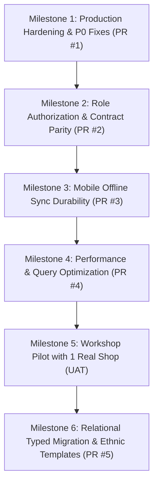

# 🚀 StitchCraft: Comprehensive Product Improvement Plan

**Target Release Window:** Q4 2026 – Q1 2027  
**Scope:** Architecture, Security, Data Layer, Backend API, Web Dashboard, Flutter Mobile, Database Migrations  
**Author:** Principal Engineer & Lead Product Systems Analyst  
**Document Status:** Pending Product Owner Approval

---

## 1. Prioritization Framework

Tasks are prioritized strictly according to user impact, financial safety, and platform stability:

- **P0: Security, Data-Loss, & Financial Correctness Bugs** — Blocker issues that crash production, bypass financial audits, leak multi-tenant access, or cause deployment failures.
- **P1: Broken or Partial Core Features** — Features that exist in the UI or docs but fail at runtime due to API contract mismatches, dead navigation routes, or authorization blocks.
- **P2: Requirement Gaps, UX Friction, & Query Performance** — Bottlenecks that slow down shop-floor operation, database full-table scans, unescaped exports, or missing essential Indian tailor capabilities.
- **P3: Codebase Quality, Dead Code Elimination, & DevOps** — Technical debt cleanup (dead mobile repository classes, unused machine module, CI linting additions, documentation sync).
- **P4: New Features & Domain Expansions** — Phone-first OTP authentication, female/ethnic garment measurement templates, and piece-rate karigar wage ledgers.

---

## 2. Actionable Engineering Tasks Matrix

---

### Priority P0: Security, Data-Loss, & Correctness Fixes

#### Task `P0-01`: Fix Vercel SPA Client-Side Routing & Dynamic CORS Configuration
- **Requirements Satisfied**: `INVOICE-01`, `SHOP-01`, `SEC-02`
- **Affected Files**:
  - `vercel.json`
  - `stitchcraft-backend/config/cors.js:4-29`
- **Exact Problem**:
  1. `vercel.json` lacks SPA rewrite rules. When customers open shared invoice links (`https://stitchcraft.app/invoice/share/<token>`) or users refresh dashboard routes, Vercel returns HTTP 404 Not Found.
  2. `config/cors.js:4-11` hardcodes static Vercel URLs and ignores `process.env.CLIENT_URL`, breaking custom deployment domains.
- **Concrete Fix**:
  1. Add standard SPA catch-all rewrite to `vercel.json`:
     ```json
     {
       "buildCommand": "cd stitchcraft-frontend && npm install && npm run build",
       "outputDirectory": "stitchcraft-frontend/dist",
       "rewrites": [{ "source": "/(.*)", "destination": "/" }]
     }
     ```
  2. In `cors.js`, dynamically parse `process.env.CLIENT_URL` into `allowedOrigins` alongside localhost and mobile user-agent exemptions.
- **Backend/DB Change Needed**: None.
- **Acceptance Criteria**: Direct browser reload on `/invoice/share/:token` and `/orders` succeeds with HTTP 200 on Vercel deployment. Cross-origin requests from `CLIENT_URL` pass CORS.
- **Tests to Add**: Add CORS origin unit test in `security_and_scoping.test.js`.
- **Effort / Dependencies**: `S` (Small, ~1 hr) | Dependencies: None | **Owner**: Web / Backend

---

#### Task `P0-02`: Resolve Multi-Role Hard Block in Backend Authentication Middleware
- **Requirements Satisfied**: `ROLE-01`, `ROLE-03`, `ROLE-04`, `ROLE-05`
- **Affected Files**:
  - `stitchcraft-backend/middleware/authMiddleware.js:44-53, 65-78`
  - `stitchcraft-backend/controllers/authController.js:307-311`
- **Exact Problem**:
  1. In `authMiddleware.js:46-50`, `protect` rejects ANY authenticated user whose role is not `'owner'` with HTTP 403: `Forbidden: role '${user.role}' is not authorized. StitchCraft is restricted to shop owners only.`
  2. `authorize()` (`authMiddleware.js:71-76`) completely ignores its `...roles` argument and hardcodes `if (userRole !== 'owner') return 403`.
  3. `authController.js:308` blocks invited staff/karigars during email verification.
- **Concrete Fix**:
  1. In `protect`, remove the hardcoded single-role check. `protect` must only authenticate user identity and attach `req.user` with their shop role.
  2. In `authorize(...allowedRoles)`, properly enforce dynamic role checking:
     ```javascript
     export const authorize = (...roles) => (req, res, next) => {
       if (!req.user) return res.status(401).json({ message: 'Not authorized' });
       const userRole = (req.user.role || 'staff').toLowerCase();
       const normalized = roles.map(r => r.toLowerCase());
       if (!normalized.includes(userRole)) {
         return res.status(403).json({
           message: `Forbidden: role '${userRole}' is not authorized for this operation.`,
         });
       }
       next();
     };
     ```
  3. In `authController.js:307`, allow invited users (`manager`, `karigar`, `staff`) to complete verification and log in.
- **Backend/DB Change Needed**: None.
- **Acceptance Criteria**: Valid JWT token for user with role `'manager'`, `'staff'`, or `'karigar'` succeeds through `protect`. Route-level `authorize('owner', 'manager')` permits managers and owners while blocking staff.
- **Tests to Add**: Extend `shop_isolation.test.js` to assert manager and staff requests succeed on permitted routes.
- **Effort / Dependencies**: `S` (Small, ~2 hrs) | Dependencies: None | **Owner**: Backend

---

#### Task `P0-03`: Enforce Delivery Credit Check on Order Updates & Close Mobile Bypass
- **Requirements Satisfied**: `DELIV-02`, `PAY-02`, `KHATA-01`
- **Affected Files**:
  - `stitchcraft-backend/services/orderService.js:481-486`
  - `stitchcraft-backend/controllers/deliveryController.js:67-101`
  - `stitchcraft-mobile/lib/features/orders/screens/deliveries_screen.dart:154-175`
- **Exact Problem**:
  1. On mobile (`deliveries_screen.dart:166-174`), marking delivery calls `PUT /api/orders/:id` with `{ status: 'Delivered' }`, skipping `PUT /api/deliveries/:id/deliver`.
  2. `orderService.js:481-486` updates the delivery record directly to `Delivered` without checking outstanding balance or requiring `allowCredit` / `creditReason`.
- **Concrete Fix**:
  1. In `orderService.js:updateOrderService`, before applying `status = 'Delivered'`, check `Payment.findOne({ orderId })`. If `balanceAmount > 0`, require `reqBody.allowCredit === true` and a non-empty `reqBody.creditReason`; otherwise throw an error.
  2. In mobile `deliveries_screen.dart:_confirmAndDeliver`, prompt the user for an optional credit reason dialog if balance > 0, and call `PUT /api/deliveries/:id/deliver` with `{ allowCredit: true, creditReason: reason }`.
- **Backend/DB Change Needed**: None.
- **Acceptance Criteria**: Any attempt to update an order with unpaid balance to `Delivered` without `allowCredit: true` and `creditReason` is rejected with HTTP 400. Credit reason is audited in order notes.
- **Tests to Add**: Add test in `financial_integrity.test.js` verifying that `PUT /api/orders/:id` rejects `{ status: 'Delivered' }` when balance > 0 without explicit credit parameters.
- **Effort / Dependencies**: `M` (Medium, ~3 hrs) | Dependencies: None | **Owner**: Backend / Mobile

---

#### Task `P0-04`: Fix Date Parsing and NaN Sorting in Ledger Cash Journal
- **Requirements Satisfied**: `KHATA-04`, `DASH-01`
- **Affected Files**:
  - `stitchcraft-backend/services/ledgerService.js:94, 116, 136-140`
- **Exact Problem**:
  - In `fetchJournalEntries`, orders are mapped using `date: o.date`. Orders do NOT possess a `date` property (they use `createdAt`).
  - `new Date(undefined)` evaluates to `NaN`. In `allEntries.sort()`, `NaN - new Date(...)` produces `NaN`, causing undefined sorting behavior and scrambled running balances.
- **Concrete Fix**:
  - In `ledgerService.js:94, 116`, map date using fallback: `date: o.createdAt || o.date || new Date().toISOString()`.
  - Validate that `a.date` and `b.date` produce valid timestamps before diffing in `allEntries.sort()`.
- **Backend/DB Change Needed**: None.
- **Acceptance Criteria**: Journal entries strictly order chronologically by timestamp. Running balance accurately reflects running cash flow across sales, refunds, payments, and expenses.
- **Tests to Add**: Add unit test in `ledger_and_expenses.test.js` verifying that orders without explicit `date` sort properly and compute monotonic running balances.
- **Effort / Dependencies**: `S` (Small, ~1 hr) | Dependencies: None | **Owner**: Backend

---

#### Task `P0-05`: Fix Unescaped CSV Concatenation in Web Ledger Export
- **Requirements Satisfied**: `DATA-04`, `KHATA-04`
- **Affected Files**:
  - `stitchcraft-frontend/src/pages/Ledger.jsx:72-90`
- **Exact Problem**:
  - `downloadCSV` concatenates values using `row.join(',')` (`Ledger.jsx:84`). Any description with a comma (e.g., `Order Booked: ORD-01 - Shirt, Pant`) splits into multiple CSV cells, corrupting columns in Excel.
- **Concrete Fix**:
  - Sanitize and quote all CSV cell values:
    ```javascript
    const escapeCsvCell = (val) => {
      const str = String(val ?? '').replace(/"/g, '""');
      return `"${str}"`;
    };
    const csvContent = [headers.map(escapeCsvCell).join(','), ...csvData.map(row => row.map(escapeCsvCell).join(','))].join('\r\n');
    ```
- **Backend/DB Change Needed**: None.
- **Acceptance Criteria**: Exported CSV opens cleanly in Microsoft Excel, Apple Numbers, and Google Sheets with order descriptions containing commas contained within a single column.
- **Tests to Add**: Add unit test in `formatters.test.js` for CSV cell escaping.
- **Effort / Dependencies**: `S` (Small, ~1 hr) | Dependencies: None | **Owner**: Web

---

### Priority P1: Broken or Partial Core Features

#### Task `P1-01`: Fix Broken Mobile Repeat Order Navigation Route
- **Requirements Satisfied**: `MEAS-05`, `CUST-03`, `ORD-01`
- **Affected Files**:
  - `stitchcraft-mobile/lib/features/orders/screens/customer_details_screen.dart:290-299`
  - `stitchcraft-mobile/lib/main.dart:150-162`
- **Exact Problem**:
  - The FloatingActionButton "Book New Order" on `customer_details_screen.dart:292` navigates to `'/create_order'`, which is undefined in `main.dart`. Tapping this crashes mobile navigation.
- **Concrete Fix**:
  - In `customer_details_screen.dart:292`, navigate to `'/create_order_step1'` (or `'/create_order_customer'`) passing customer arguments:
    ```dart
    Navigator.pushNamed(
      context,
      '/create_order_customer',
      arguments: {
        'customerId': custId,
        'customerName': custName,
        'customerPhone': custPhone,
        'measurements': _customerData!['measurements'],
      },
    );
    ```
  - In `main.dart`, register alias `'/create_order': (context) => const Step2CustomerScreen()` as a safety fallback.
- **Backend/DB Change Needed**: None.
- **Acceptance Criteria**: Tapping "Book New Order" from customer profile on mobile opens order wizard with customer pre-selected and past measurements ready for reuse.
- **Tests to Add**: Add widget test in `test/widget_test.dart` verifying tapping FAB on `CustomerDetailsScreen` does not throw an unknown route exception.
- **Effort / Dependencies**: `S` (Small, ~1 hr) | Dependencies: None | **Owner**: Mobile

---

#### Task `P1-02`: Harmonize Staff Roles Contract & Enable Manager Staff List View
- **Requirements Satisfied**: `ROLE-01`, `ROLE-03`, `ROLE-06`
- **Affected Files**:
  - `stitchcraft-frontend/src/pages/StaffManagement.jsx:36, 266-268, 386-390`
  - `stitchcraft-backend/routes/staffRoutes.js:14-24`
  - `stitchcraft-backend/controllers/staffController.js:8-32`
- **Exact Problem**:
  1. Frontend dropdown has `<option value="admin">Admin</option>` instead of allowed roles `['manager', 'karigar', 'staff']`. Submitting "admin" fails with 400.
  2. `staffRoutes.js:16` applies `authorize('owner')` to `GET /api/staff`, blocking managers with 403 even though `Sidebar.jsx:36` shows the menu to managers.
- **Concrete Fix**:
  1. In `StaffManagement.jsx`, align dropdown options with backend schema: `<option value="manager">{t('roleManager')}</option>`, `<option value="karigar">{t('roleKarigar')}</option>`, `<option value="staff">{t('roleStaff')}</option>`.
  2. In `staffRoutes.js`, relax `GET /` to `authorize('owner', 'manager')` while keeping write/delete routes (`POST /`, `PUT /:id/role`, `DELETE /:id`) strictly `authorize('owner')`.
- **Backend/DB Change Needed**: None.
- **Acceptance Criteria**: Shop owner can successfully invite or change role to "Manager", "Karigar", or "Staff". Manager can view team list but cannot edit roles or delete staff.
- **Tests to Add**: Extend `staff_management.test.js` to assert manager can `GET /api/staff` and cannot `PUT /api/staff/:id/role`.
- **Effort / Dependencies**: `S` (Small, ~2 hrs) | Dependencies: `P0-02` | **Owner**: Web / Backend

---

#### Task `P1-03`: Unify Password Reset Flow Between Frontend and Backend
- **Requirements Satisfied**: `AUTH-04`, `AUTH-05`
- **Affected Files**:
  - `stitchcraft-backend/routes/authRoutes.js:37-38`
  - `stitchcraft-backend/controllers/authController.js:419-436`
  - `stitchcraft-frontend/src/context/AuthContext.jsx:134-162`
  - `stitchcraft-frontend/src/pages/ResetPassword.jsx:25-59`
- **Exact Problem**:
  - Backend route `POST /api/auth/reset-password` has `protect` middleware (`authRoutes.js:38`), requiring an active user session token.
  - Frontend `AuthContext.jsx:153` bypasses backend and calls client Supabase directly.
- **Concrete Fix**:
  - Remove `protect` from `POST /api/auth/reset-password`. Accept `{ token_hash, password }` or authenticate the recovery bearer token from URL fragment hash using `supabase.auth.getUser(token)` within the controller.
  - Wire `AuthContext.jsx:resetPassword` to call backend `api.post('/auth/reset-password')` so rate-limiting and audit logging are preserved.
- **Backend/DB Change Needed**: None.
- **Acceptance Criteria**: User clicking reset link in email can enter new password and reset it without encountering HTTP 401.
- **Tests to Add**: Unit test in `auth_and_validation.test.js` verifying password reset without pre-existing session.
- **Effort / Dependencies**: `M` (Medium, ~2 hrs) | Dependencies: None | **Owner**: Backend / Web

---

#### Task `P1-04`: Expand Mobile Background Sync Coverage & Retire Dead Repositories
- **Requirements Satisfied**: `SYNC-01`, `SYNC-02`, `KAR-01`, `INV-01`
- **Affected Files**:
  - `stitchcraft-mobile/lib/core/services/sync_service.dart:45, 67, 246`
  - `stitchcraft-mobile/lib/core/repositories/order_repository.dart`
  - `stitchcraft-mobile/lib/core/repositories/customer_repository.dart`
  - `stitchcraft-mobile/lib/core/repositories/ledger_repository.dart`
  - `stitchcraft-mobile/lib/core/repositories/inventory_repository.dart`
- **Exact Problem**:
  1. `sync_service.dart` only synchronizes `['customers', 'orders', 'expenses', 'inventory']`. `karigars` and `shop` profile settings are never synced.
  2. The four repository classes and `mutation_outbox` enqueue calls are dead code bypassed by the screens.
- **Concrete Fix**:
  1. Add `'karigars'` to the synced tables list in `sync_service.dart`. Pull karigar records and persist to SQLite so artisans can be assigned offline.
  2. Either wire screens to use the repositories with durable outbox mutations OR remove the dead repository classes and document `LocalDatabaseService` as the single mobile data access layer.
- **Backend/DB Change Needed**: Ensure `GET /api/karigars` is accessible for offline sync.
- **Acceptance Criteria**: Adding a karigar on web appears in mobile app after background sync. Sync Status screen reflects accurate sync counts.
- **Tests to Add**: Mobile test verifying `syncTable('karigars')` populates SQLite `karigars` table.
- **Effort / Dependencies**: `M` (Medium, ~4 hrs) | Dependencies: `P0-02` | **Owner**: Mobile

---

#### Task `P1-05`: Enforce Role Authorization Across All Sensitive Backend Routes
- **Requirements Satisfied**: `ROLE-01`, `ROLE-02`, `ROLE-04`, `SEC-02`
- **Affected Files**:
  - `stitchcraft-backend/routes/ledgerRoutes.js:18-23`
  - `stitchcraft-backend/routes/customerRoutes.js:17-25`
  - `stitchcraft-backend/routes/orderRoutes.js:35-52`
  - `stitchcraft-backend/routes/inventoryRoutes.js:12-25`
  - `stitchcraft-backend/routes/karigarRoutes.js:12-25`
  - `stitchcraft-backend/routes/machineRoutes.js:12-25`
- **Exact Problem**:
  - Sensitive financial and destructive endpoints lack `authorize()`. Any authenticated user in the shop can view total profits (`/ledger/summary`), journal entries, udhar balances, or delete orders and inventory.
- **Concrete Fix**:
  - `routes/ledgerRoutes.js`: Apply `authorize('owner', 'manager')` to `/summary`, `/journal`, `/transactions`, `/expenses`.
  - `routes/customerRoutes.js`: Apply `authorize('owner', 'manager')` to `/pending-balances`, and `authorize('owner')` to `DELETE /:id`.
  - `routes/orderRoutes.js`: Apply `authorize('owner')` to `DELETE /:id`.
  - `routes/inventoryRoutes.js`: Apply `authorize('owner')` to `DELETE /:id`.
- **Backend/DB Change Needed**: None.
- **Acceptance Criteria**: Staff or karigar tokens receive HTTP 403 Forbidden when attempting to view ledger summaries or delete domain entities.
- **Tests to Add**: Add comprehensive route permission tests in `staff_management.test.js`.
- **Effort / Dependencies**: `S` (Small, ~2 hrs) | Dependencies: `P0-02` | **Owner**: Backend

---

### Priority P2: Requirement Gaps & Performance Optimization

#### Task `P2-01`: Push Database Query Filtering to PostgreSQL & Eliminate N+1 Scans
- **Requirements Satisfied**: `DASH-01`, `ORD-01`, `SEC-02`
- **Affected Files**:
  - `stitchcraft-backend/config/supabaseModel.js:173-188, 269-274`
  - `stitchcraft-backend/controllers/orderController.js:88-100`
  - `stitchcraft-backend/controllers/dashboardController.js:20-115`
- **Exact Problem**:
  - In `supabaseModel.js`, queries with `$or` conditions do not push `shopId` to Supabase, triggering full-collection downloads over HTTP.
  - Controller loops execute individual `findOne` calls for payments and deliveries per order, triggering over 100 HTTP requests per page load.
- **Concrete Fix**:
  1. In `supabaseModel.js:load`, extract `shopId` from `$or` clauses (e.g., `{ $or: [{ shopId }, { delegatedToShopId: shopId }] }`) and push an `.or(...)` filter to the PostgREST query builder.
  2. Implement batch population in `SupabaseQuery`: fetch all payments and deliveries for the result set in single `in('orderId', orderIds)` queries rather than in a loop.
- **Backend/DB Change Needed**: Add index on `app_records (((document->>'orderId')))` for faster relation lookups.
- **Acceptance Criteria**: Order list and Dashboard API response times drop from >1500ms to <150ms under a test dataset of 2,000 orders.
- **Tests to Add**: Add query benchmark test measuring database roundtrips.
- **Effort / Dependencies**: `L` (Large, ~6 hrs) | Dependencies: None | **Owner**: Backend / DB

---

#### Task `P2-02`: Clean Up Hardcoded English Strings Across Mobile & Web
- **Requirements Satisfied**: `LOC-01`, `LOC-02`
- **Affected Files**:
  - `stitchcraft-mobile/lib/features/orders/screens/deliveries_screen.dart:133, 146, 179`
  - `stitchcraft-mobile/lib/features/orders/screens/create_order/step5_details.dart:238, 471`
  - `stitchcraft-mobile/lib/features/repairs/screens/repair_dashboard.dart:69, 93`
  - `stitchcraft-frontend/src/pages/StaffManagement.jsx:387`
- **Exact Problem**:
  - Several key user feedback messages ("Order marked as Delivered!", "Order saved locally!", "Confirm Delivery", "No pending deliveries") are hardcoded in English, failing Hindi and Gujarati workshop users.
- **Concrete Fix**:
  - Add missing keys to `app_en.arb`, `app_gu.arb`, `app_hi.arb` and `locales/en.json`, `gu.json`, `hi.json`. Replace all raw `Text('...')` with `context.loc.<key>` and `t('<key>')`.
- **Backend/DB Change Needed**: None.
- **Acceptance Criteria**: Zero raw English user-facing strings displayed when switching to Hindi or Gujarati.
- **Tests to Add**: Add flutter test scanning ARB completeness.
- **Effort / Dependencies**: `S` (Small, ~2 hrs) | Dependencies: None | **Owner**: Mobile / Web

---

#### Task `P2-03`: Add UPI Payment Proof / UTR Entry to Public Invoice
- **Requirements Satisfied**: `INVOICE-05`, `PAY-01`
- **Affected Files**:
  - `stitchcraft-frontend/src/pages/PublicInvoice.jsx:309-328`
  - `stitchcraft-backend/routes/orderRoutes.js`
  - `stitchcraft-backend/controllers/orderController.js`
- **Exact Problem**:
  - When a customer pays via UPI app from the public invoice, P2P UPI provides no callback. The invoice stays "Balance Due" until the masterji notices a bank SMS and manually records it.
- **Concrete Fix**:
  - Add a "Confirm UPI Payment" section on `PublicInvoice.jsx` where the customer enters their 12-digit UPI Reference / UTR Number or uploads a payment screenshot.
  - Create public endpoint `POST /api/orders/public/:token/payment-submission` that notifies the masterji: "Customer Ramesh submitted payment proof (UTR: 329182391823) for Order ORD-01".
- **Backend/DB Change Needed**: Add `paymentProof` field to `Order` document.
- **Acceptance Criteria**: Customer can enter UTR number on invoice link; masterji receives an immediate in-app notification to verify and settle payment with one click.
- **Tests to Add**: Add public invoice payment submission test.
- **Effort / Dependencies**: `M` (Medium, ~4 hrs) | Dependencies: `P0-01` | **Owner**: Web / Backend

---

#### Task `P2-04`: Add Mobile Monthly Financial Summary & PDF/CSV Export for Accountants
- **Requirements Satisfied**: `DATA-04`, `KHATA-04`
- **Affected Files**:
  - `stitchcraft-mobile/lib/features/khata/screens/khata_screen.dart`
  - `stitchcraft-mobile/lib/core/services/pdf_service.dart`
- **Exact Problem**:
  - Mobile has no export feature for Khata or expenses. Masterjis managing their shop exclusively on mobile cannot generate a monthly statement for their tax accountant.
- **Concrete Fix**:
  - Add an "Export Statement" button in the app bar of `KhataScreen.dart`.
  - Allow selecting month (e.g., "October 2026") and generate an itemized PDF / CSV statement containing total sales, cash collected, and shop expenses.
- **Backend/DB Change Needed**: None (computes from local SQLite).
- **Acceptance Criteria**: Masterji can tap "Export Statement" on mobile and share a clean PDF or CSV directly via WhatsApp to their accountant.
- **Tests to Add**: Add PDF generation unit test in `test/unit_test.dart`.
- **Effort / Dependencies**: `M` (Medium, ~4 hrs) | Dependencies: None | **Owner**: Mobile

---

### Priority P3: Code Quality, Cleanup, & Technical Debt

#### Task `P3-01`: Retire Machine Maintenance Module or Build Mobile Parity
- **Requirements Satisfied**: `MACH-01`, `MACH-02`
- **Affected Files**:
  - `stitchcraft-frontend/src/App.jsx:64`
  - `stitchcraft-frontend/src/components/layout/Sidebar.jsx:32`
  - `stitchcraft-frontend/src/pages/Machines.jsx`
  - `stitchcraft-backend/routes/machineRoutes.js`
- **Exact Problem**:
  - Feature exists only on web, is completely missing on mobile, and addresses a non-critical workflow for small tailoring shops.
- **Concrete Fix**:
  - **Recommended Action**: Demote `/machines` from the primary web sidebar and group it under Shop Settings / Advanced, or archive the routes to streamline the product core. (See Product Owner Decisions below).
- **Backend/DB Change Needed**: None.
- **Acceptance Criteria**: Simplified navigation without dead or half-implemented modules.
- **Effort / Dependencies**: `S` (Small, ~1 hr) | Dependencies: None | **Owner**: Web

---

#### Task `P3-02`: Normalized Typed Tables Database Migration Plan
- **Requirements Satisfied**: `SHOP-01`, `ORD-01`, `SEC-02`
- **Affected Files**:
  - `supabase/migrations/20261030150000_stitchcraft_schema.sql`
  - `stitchcraft-backend/scripts/migrate_to_relational.js`
  - `stitchcraft-backend/config/supabaseModel.js`
- **Exact Problem**:
  - Database currently stores all data in single JSONB `app_records` table with compatibility adapters. Domain tables exist in migrations but are unused.
- **Concrete Fix**:
  - Phase 1: Keep `app_records` for production stability while improving query indexes.
  - Phase 2: Refactor `supabaseModel.js` to write directly to typed domain tables (`public.orders`, `public.customers`, `public.payments`) with typed columns for primary search fields (`shop_id`, `status`, `delivery_date`, `created_at`) while retaining `document jsonb` for flexible attributes.
- **Backend/DB Change Needed**: Apply typed column indexes on domain tables.
- **Acceptance Criteria**: Zero data loss during cutover; tests pass against typed tables.
- **Effort / Dependencies**: `L` (Large, ~8 hrs) | Dependencies: `P2-01` | **Owner**: Backend / DB

---

### Priority P4: New Features & Domain Expansions

#### Task `P4-01`: Phone-First OTP Authentication (Firebase / Twilio / MSG91)
- **Requirements Satisfied**: `AUTH-09`
- **Affected Files**: `stitchcraft-backend/controllers/authController.js`, `stitchcraft-mobile/lib/features/auth/`
- **Problem**: Masterjis find passwords and email verification cumbersome.
- **Fix**: Integrate Firebase Phone Auth on mobile/web with fallback to email/password.
- **Effort**: `L` | **Owner**: Backend / Mobile

#### Task `P4-02`: Vernacular Female & Ethnic Garment Measurement Templates
- **Requirements Satisfied**: `MEAS-07`
- **Affected Files**: `Measurement.js`, `MeasurementForm.jsx`, `step3_measurements.dart`
- **Problem**: No templates for Blouse, Kurti, Salwar-Kameez, or Lehanga.
- **Fix**: Add dynamic measurement definition schema supporting custom garment templates with visual measurement diagrams.
- **Effort**: `L` | **Owner**: Full-Stack

#### Task `P4-03`: Karigar Piece-Rate Wage Calculation & Payout Ledger
- **Requirements Satisfied**: `KAR-02`, `KHATA-03`
- **Affected Files**: `models/Karigar.js`, `karigarController.js`, `my_jobs_screen.dart`
- **Problem**: No tracking of piece-rate wages owed to karigars.
- **Fix**: Add piece-rate price per order item, track karigar balance, and generate weekly wage payout receipts.
- **Effort**: `M` | **Owner**: Backend / Mobile

---

## 3. Milestones & Shippable PR Sequencing

Each milestone is designed as a standalone, non-breaking Pull Request:



### Detailed Sequence
1. **Milestone 1 (PR #1) — Production & Integrity Quick Wins** (Est: 1 day):
   - Vercel SPA rewrites (`P0-01`).
   - Delivery credit bypass fix (`P0-03`).
   - Ledger journal date sorting NaN fix (`P0-04`).
   - Unescaped CSV export fix (`P0-05`).
2. **Milestone 2 (PR #2) — Multi-Role Authorization & Contract Alignment** (Est: 1.5 days):
   - Remove owner-only hard block from `authMiddleware.js` (`P0-02`).
   - Harmonize Staff Management roles dropdown on frontend (`P1-02`).
   - Fix password reset route contract (`P1-03`).
   - Add `authorize()` to sensitive ledger and delete routes (`P1-05`).
3. **Milestone 3 (PR #3) — Mobile Sync Durability & Route Corrections** (Est: 2 days):
   - Fix broken repeat order route on mobile customer details (`P1-01`).
   - Include `karigars` in mobile sync table loop (`P1-04`).
   - Replace hardcoded English strings with localization keys (`P2-02`).
   - Add mobile financial statement export (`P2-04`).
4. **Milestone 4 (PR #4) — Database Query Optimization & UPI Proof** (Est: 2 days):
   - Push `shopId` and `$or` filters to Supabase query builder (`P2-01`).
   - Batch populate order relations to eliminate N+1 full scans (`P2-01`).
   - Add customer UPI reference submission on public invoice (`P2-03`).
5. **Milestone 5 — Real-World Workshop Pilot**:
   - Pilot with 1 real Masterji boutique in Gujarat/Maharashtra for 7 consecutive days.
   - Measure daily order volume, sync durability, and WhatsApp delivery pickup response.
6. **Milestone 6 (PR #5) — Normalized Relational Migration & Ethnic Wear**:
   - Cut over from `app_records` JSONB to typed columns.
   - Implement female ethnic wear measurement templates (Blouse, Kurti).

---

## 4. Test & Release Plan

### 4.1 Automated Test Gates
- **Unit Tests**:
  - Backend: Run `npm test` (57 tests passing). Add tests for CORS, delivery credit checks, and non-owner role authorization.
  - Frontend: Run `npm test` (18 tests passing). Add tests for CSV cell escaping and role option mappings.
  - Mobile: Run `flutter test` across `unit_test.dart` and `widget_test.dart`.
- **API Integration Tests**:
  - Verify tenant isolation: Shop B cannot query Shop A order by ID.
  - Verify public invoice: Requesting `/api/orders/public/:token` with random string returns 400; with MongoDB `_id` returns 404; with valid token returns sanitized payload.
- **Offline Sync Stress Scenarios**:
  1. *Airplane Mode Order Booking*: Put device in Airplane Mode -> Book 3 multi-item orders -> Reconnect WiFi -> Assert orders appear in web dashboard with identical prices and measurements.
  2. *Concurrent Mutation Test*: Modify order status to "Stitching" on web while offline phone has status "Cutting". Reconnect -> Assert server timestamp precedence or conflict visibility in Sync Status screen.
  3. *ID Remapping Cascade*: Create customer offline -> create order for customer offline -> Sync -> Assert `orders.customer_id` updates to server customer ID without orphaned records.

### 4.2 User Acceptance Testing (UAT) with 3 to 5 Tailor Shops
- **Cohort**: 3 to 5 independent tailor shops in Ahmedabad / Surat / Mumbai (Hindi and Gujarati speaking).
- **Target Workflows**:
  1. Morning rush: taking measurements with tape and fraction pad in under 90 seconds.
  2. Evening rush: marking deliveries, collecting cash/UPI, and confirming balance on credit.
  3. Sunday Udhar chasing: sending 10 WhatsApp reminders in under 3 minutes.
- **Success Metrics (KPIs)**:
  - **Zero Data Loss**: 100% of offline orders successfully synced after network restoration.
  - **Booking Speed**: Order creation completed in < 90 seconds on mobile.
  - **Customer WhatsApp Open Rate**: > 80% of customers open shared public invoice link.
  - **Crash-Free Sessions**: > 99.5% crash-free mobile sessions.

---

## 5. Decisions Requiring Product Owner Sign-Off

The following architectural and design decisions require confirmation from the Product Owner:

| Decision | Option A | Option B | Recommended Default | Rationale |
|---|---|---|---|---|
| **1. Primary Auth Mechanism** | Phone OTP (SMS/WhatsApp) | Email + Password | **Option A for Mobile, Option B for Web** | Indian masterjis struggle with passwords; mobile must adopt phone OTP, while web admin can retain email/password. |
| **2. Role System Scope** | Enforce full 4-role matrix (`owner`, `manager`, `staff`, `karigar`) | Simplify to 2 roles (`owner`, `staff`) | **Option A (Full 4-role matrix)** | The UI and models are already built for 4 roles; unblocking `authMiddleware.js` restores intended functionality with minimal effort. |
| **3. Machine Maintenance Module** | Keep on web and build mobile parity | Demote/archive from main navigation | **Option B (Demote from main navigation)** | Small tailor shops do not track machine serials. Retiring it reduces cognitive overload on the counter staff. |
| **4. Public UPI Payment Flow** | P2P UPI QR + Customer UTR reference entry | Integrated Payment Gateway (Razorpay/Cashfree) | **Option A (P2P UPI + UTR entry)** | Payment gateways charge 2% transaction fee and require formal business registration/KYC, which informal masterjis actively avoid. |
| **5. Database Schema Evolution** | Migrate to typed tables immediately | Retain `app_records` JSONB with optimized indexes | **Option B for Pilot, Option A for Scale** | Retaining `app_records` with pushed query filters avoids data migration risk during upcoming tailor shop pilot. |

---

## 6. Risks, Assumptions, & What NOT to Change Yet

### 6.1 Critical Risks
1. **Host Environment Flutter Tooling**: Host machine lacks Flutter SDK binary (`flutter: command not found`). While GitHub Actions CI passes, local mobile builds require installing the Flutter SDK matching Dart 3.13.7.
2. **Third-Party QR Service Dependency**: `PublicInvoice.jsx:312` calls external `api.qrserver.com` to render UPI QR codes. If this third-party service is blocked or slow, the UPI QR will fail to display. A local SVG/Canvas QR generator (e.g., `qrcode.react`) should replace it.

### 6.2 What NOT to Change Yet
1. **DO NOT Rewrite Database Schema to Relational Typed Tables Before Pilot**: The current JSONB `app_records` adapter functions reliably under automated tests. Rewriting the entire persistence layer before running the workshop pilot introduces severe regression risk.
2. **DO NOT Remove Tri-Lingual Support**: Localization in Hindi and Gujarati is StitchCraft's greatest competitive moat against generic Western ERPs.
3. **DO NOT Add Complex Cloud Karigar Portals**: Keep karigar interactions local to the workshop device or physical garment job slips until the core shop-owner journey is fully mastered.

