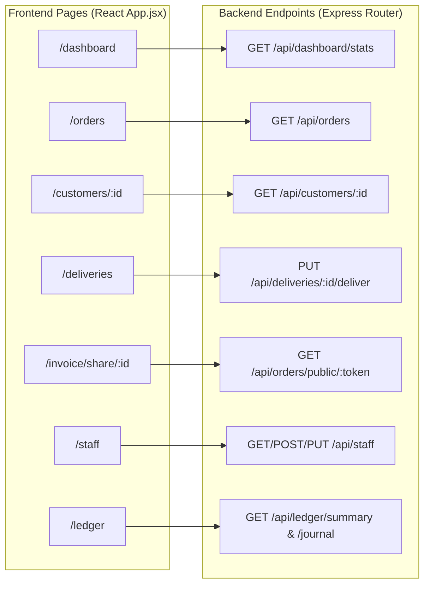

# 📡 StitchCraft — Complete API Reference & Security Audit

---

## 1. API Architecture & Conventions

### 1.1 Base Configuration & Protocol
- **Base URL**: `http://localhost:5000/api` (Development) / `https://stitchcraft-backend.onrender.com/api` (Production)
- **Data Exchange**: JSON (`Content-Type: application/json; charset=utf-8`)
- **Authentication**: Bearer Token via Supabase Auth GoTrue JWT (`Authorization: Bearer <token>`)
- **Tenant Context**: Automatically resolved from authenticated user document (`req.user.shopId`)

### 1.2 Global Middleware Execution Pipeline
Every incoming HTTP request traverses the pipeline in strict sequential order:

```mermaid
graph LR
    Req[Incoming HTTP Request] --> CORS[1. CORS Policy cors.js]
    CORS --> Helmet[2. Helmet Security Headers]
    Helmet --> DestructLimit[3. Global DELETE Destructive Limiter]
    DestructLimit --> RouteMatch[4. Express Route Match]
    RouteMatch --> RouteLimit[5. Tiered Route Rate Limiter]
    RouteLimit --> Validation[6. Request Validation Middleware]
    Validation --> Protect[7. Auth Token Verification protect]
    Protect --> Authorize[8. Role Verification authorize]
    Authorize --> Controller[9. Domain Controller]
    Controller --> Service[10. Domain Service]
    Service --> ErrorHandler[11. Centralized Error Handler]
```

### 1.3 Multi-Tier Rate Limiting Architecture (`express-rate-limit`)
| Limiter Name | Rate Window | Max Requests | Target Routes |
|---|---|---|---|
| `generalLimiter` | 15 minutes | 300 requests | All `/api/*` endpoints |
| `authLimiter` | 15 minutes | 10 requests | `/api/auth/register`, `/login`, `/verify`, `/forgot-password`, `/reset-password` |
| `uploadLimiter` | 15 minutes | 30 requests | `/api/upload/*` (signed URL generation) |
| `destructiveLimiter`| 15 minutes | 10 requests | Sensitive actions (`/account/*`, `/update-password`, and **all HTTP `DELETE` requests**) |
| `publicInvoiceLimiter` | 15 minutes | 60 requests | `/api/orders/public/:token` (Guest invoice access) |

---

## 2. Comprehensive Endpoint Catalog (70 Endpoints)

### 2.1 System & Health (`/api`)
| Method | Endpoint | Auth | Role | Controller & Service | Collections Affected | Frontend Usage | Status |
|---|---|---|---|---|---|---|---|
| `GET` | `/api/status` | Public | None | Inline in `routes/index.js:27` | None | Health checks / Monitoring | Complete & Verified |

---

### 2.2 Authentication & Account Lifecycle (`/api/auth`)
| Method | Endpoint | Auth | Role | Validation Rules | Controller & Handler | Frontend Usage | Status |
|---|---|---|---|---|---|---|---|
| `POST` | `/api/auth/register` | Public | None | Name >= 2, valid email, password >= 6, phone 10-15 | `authController.registerUser` | `Signup.jsx`, `signup_screen.dart` | Complete & Verified |
| `POST` | `/api/auth/login` | Public | None | Email & password required | `authController.loginUser` | `Login.jsx`, `login_screen.dart` | Complete & Verified |
| `POST` | `/api/auth/verify` | Public | None | Token & email required | `authController.verifyEmail` | Email verification links | Complete & Verified |
| `POST` | `/api/auth/resend-verification` | Public | None | Email required | `authController.resendVerification` | Verification prompt | Complete & Verified |
| `POST` | `/api/auth/forgot-password` | Public | None | Email format & length <= 254 | `authController.forgotPassword` | `ForgotPassword.jsx` | Complete & Verified |
| `POST` | `/api/auth/reset-password` | Protected | Any | Password length >= 6 | `authController.resetPassword` | `ResetPassword.jsx` | Complete & Verified |
| `GET` | `/api/auth/profile` | Protected | Any | Active session | `profileController.getUserProfile` | `Profile.jsx`, `profile_screen.dart` | Complete & Verified |
| `PUT` | `/api/auth/profile` | Protected | Any | Name/phone validation | `profileController.updateUserProfile` | `ProfileTab.jsx` | Complete & Verified |
| `PUT` | `/api/auth/switch-shop/:id` | Protected | Any | Shop membership verification | `profileController.switchActiveShop` | `ShopInfoTab.jsx`, `drawer_menu.dart` | Complete & Verified |
| `PUT` | `/api/auth/update-password` | Protected | Any | Old & new password validation | `authController.updatePassword` | `ChangePasswordTab.jsx` | Complete & Verified |
| `POST` | `/api/auth/verify-password` | Protected | Any | Password string required | `authController.verifyPasswordOnly` | Privacy modals | Complete & Verified |
| `POST` | `/api/auth/account/download-data` | Protected | `owner` | Owner role check | `accountController.downloadAllData` | `Profile.jsx` (Export) | Complete & Verified |
| `POST` | `/api/auth/account/delete-all-data` | Protected | `owner` | Owner role check | `accountController.deleteAllData` | `Profile.jsx` (Wipe) | Complete & Verified |
| `POST` | `/api/auth/account/delete-account` | Protected | `owner` | Owner role check | `accountController.deleteAccountRequest`| `Profile.jsx` (Delete) | Complete & Verified |
| `POST` | `/api/auth/account/check-conflicts`| Protected | `owner` | Import JSON schema check | `accountController.checkImportConflicts` | `DataConflictModal.jsx` | Complete & Verified |
| `POST` | `/api/auth/account/import-data` | Protected | `owner` | Resolved entities payload | `accountController.importAllData` | `DataConflictModal.jsx` | Complete & Verified |

---

### 2.3 Dashboard & Analytics (`/api/dashboard`)
| Method | Endpoint | Auth | Role | Controller & Handler | Collections Read | Frontend Usage | Status |
|---|---|---|---|---|---|---|---|
| `GET` | `/api/dashboard/stats` | Protected | Any (with shop) | `dashboardController.getDashboardStats` | `orders`, `payments`, `karigars`, `machines`, `inventory` | `Dashboard.jsx`, `DashboardScreen.dart` | Complete & Verified |

---

### 2.4 Multi-Shop Management (`/api/shops`)
| Method | Endpoint | Auth | Role | Validation Rules | Controller & Handler | Frontend Usage | Status |
|---|---|---|---|---|---|---|---|
| `GET` | `/api/shops/partners` | Protected | Any | Scoped by city/phone | `shopController.getPartnerTailors` | Outsource delegation modal | Complete & Verified |
| `GET` | `/api/shops` | Protected | Any | User shop associations | `shopController.getShops` | `ShopModal.jsx`, `profile_screen.dart` | Complete & Verified |
| `POST` | `/api/shops` | Protected | Any | Shop name >= 2 | `shopController.createShop` | `ShopModal.jsx`, `shop_setup_screen.dart` | Complete & Verified |
| `GET` | `/api/shops/:id` | Protected | Any | Valid shop identifier | `shopController.getShopById` | `ShopInfoTab.jsx` | Complete & Verified |
| `PUT` | `/api/shops/:id` | Protected | Any | UPI VPA / GSTIN checks | `shopController.updateShop` | `ShopSettingsScreen.dart`, `ShopModal.jsx` | Complete & Verified |
| `DELETE` | `/api/shops/:id` | Protected | `owner` | Owner authorization | `shopController.deleteShop` | `DeleteShopModal.jsx` | Complete & Verified |

---

### 2.5 Customers & Measurements (`/api/customers`)
| Method | Endpoint | Auth | Role | Validation Rules | Controller & Handler | Frontend Usage | Status |
|---|---|---|---|---|---|---|---|
| `GET` | `/api/customers/pending-balances` | Protected | Any | ShopId scoping | `customerController.getPendingBalances` | `PendingBalancesTab.jsx`, `UdharList.dart` | Complete & Verified |
| `GET` | `/api/customers/:id/profile` | Protected | Any | ID lookup | `customerController.getCustomerById` | Mobile client parity | Complete & Verified |
| `GET` | `/api/customers` | Protected | Any | Search query filtering | `customerController.getCustomers` | `Customers.jsx`, `CustomerListScreen.dart` | Complete & Verified |
| `POST` | `/api/customers` | Protected | Any | Name >= 2, phone 10-15 | `customerController.createCustomer` | `Customers.jsx`, `step2_customer.dart` | Complete & Verified |
| `GET` | `/api/customers/:id` | Protected | Any | Customer ID lookup | `customerController.getCustomerById` | `CustomerDetails.jsx`, `customer_details_screen.dart` | Complete & Verified |
| `PUT` | `/api/customers/:id` | Protected | Any | Name/phone validation | `customerController.updateCustomer` | `CustomerDetails.jsx` | Complete & Verified |
| `DELETE` | `/api/customers/:id` | Protected | Any | Destructive limiter | `customerController.deleteCustomer` | `CustomerDetails.jsx` | Complete & Verified |

---

### 2.6 Orders & Production Workflow (`/api/orders`)
| Method | Endpoint | Auth | Role | Validation Rules | Controller & Handler | Frontend Usage | Status |
|---|---|---|---|---|---|---|---|
| `GET` | `/api/orders/public/:token` | **Public** | None | Opaque shareToken check | `orderController.getOrderByIdPublic` | `PublicInvoice.jsx` (`/invoice/share/:id`) | Complete & Verified |
| `GET` | `/api/orders` | Protected | Any | Status/urgency filters | `orderController.getOrders` | `Orders.jsx`, `OrderListScreen.dart` | Complete & Verified |
| `POST` | `/api/orders` | Protected | Any | Customer, price >= 0, date | `orderController.createOrder` | `NewOrder.jsx`, `step5_details.dart` | Complete & Verified |
| `GET` | `/api/orders/:id` | Protected | Any | Order ID lookup | `orderController.getOrderById` | `OrderDetails.jsx`, `OrderDetailsScreen.dart` | Complete & Verified |
| `PUT` | `/api/orders/:id` | Protected | Any | Status enum validation | `orderController.updateOrder` | `Orders.jsx`, `EditOrder.jsx` | Complete & Verified |
| `DELETE` | `/api/orders/:id` | Protected | Any | Cascade payments/txs | `orderController.deleteOrder` | `DeleteOrderModal.jsx` | Complete & Verified |
| `POST` | `/api/orders/:id/payments` | Protected | Any | Amount > 0, tender enum | `orderController.recordOrderPayment` | `PaymentModal.jsx` | Complete & Verified |
| `POST` | `/api/orders/:id/refunds` | Protected | Any | Amount > 0, reason string | `orderController.recordOrderRefund` | `PaymentModal.jsx` (Refunds) | Complete & Verified |
| `POST` | `/api/orders/:id/payments/refund`| Protected | Any | Alias for refunds | `orderController.recordOrderRefund` | API Parity route | Complete & Verified |
| `POST` | `/api/orders/:id/notes` | Protected | Any | Non-empty note string | `orderController.addNoteToOrder` | `OrderDetails.jsx` (Notes) | Complete & Verified |
| `POST` | `/api/orders/:id/share-token` | Protected | Any | Generates opaque token | `orderController.generateShareToken` | `InvoiceDetails.jsx`, `invoice_details_screen.dart` | Complete & Verified |
| `POST` | `/api/orders/:id/revoke-share-token`| Protected | Any | Invalidates token | `orderController.revokeShareToken` | `InvoiceDetails.jsx` | Complete & Verified |
| `POST` | `/api/orders/:id/share-token/revoke`| Protected | Any | Alias for revocation | `orderController.revokeShareToken` | API Parity route | Complete & Verified |
| `POST` | `/api/orders/:id/delegate` | Protected | Any | Partner shop ID & cost | `orderController.delegateOrder` | Partner outsourcing modal | Complete & Verified |
| `POST` | `/api/orders/:id/revoke-delegation` | Protected | Any | Revokes partner handoff | `orderController.revokeDelegation` | Partner outsourcing modal | Complete & Verified |

---

### 2.7 Khata Ledger & Expenses (`/api/ledger`)
| Method | Endpoint | Auth | Role | Validation Rules | Controller & Handler | Frontend Usage | Status |
|---|---|---|---|---|---|---|---|
| `GET` | `/api/ledger/summary` | Protected | Any | ShopId scoping | `ledgerController.getLedgerSummary` | `Ledger.jsx`, `KhataScreen.dart` | Complete & Verified |
| `GET` | `/api/ledger/journal` | Protected | Any | Chronological running cash | `ledgerController.getJournalEntries` | `Ledger.jsx` (Journal Tab) | Complete & Verified |
| `GET` | `/api/ledger/transactions` | Protected | Any | Order payments log | `ledgerController.getTransactions` | `Payments.jsx` | Complete & Verified |
| `GET` | `/api/ledger/expenses` | Protected | Any | Filter by category | `expenseController.getExpenses` | `Ledger.jsx`, `ExpensesList.dart` | Complete & Verified |
| `POST` | `/api/ledger/expenses` | Protected | Any | Amount > 0, category req | `expenseController.createExpense` | `Ledger.jsx`, `KhataScreen.dart` | Complete & Verified |
| `DELETE` | `/api/ledger/expenses/:id` | Protected | `owner` | Owner authorization | `expenseController.deleteExpense` | `Ledger.jsx` | Complete & Verified |

---

### 2.8 Deliveries (`/api/deliveries`)
| Method | Endpoint | Auth | Role | Validation Rules | Controller & Handler | Frontend Usage | Status |
|---|---|---|---|---|---|---|---|
| `GET` | `/api/deliveries` | Protected | Any | Delivery records list | `deliveryController.getDeliveries` | `Delivery.jsx`, `DeliveriesScreen.dart` | Complete & Verified |
| `PUT` | `/api/deliveries/:id/deliver` | Protected | Any | Credit reason if unpaid | `deliveryController.markAsDelivered` | `Delivery.jsx` | Complete & Verified |

---

### 2.9 Notifications & Push (`/api/notifications`)
| Method | Endpoint | Auth | Role | Controller & Handler | Frontend Usage | Status |
|---|---|---|---|---|---|---|
| `GET` | `/api/notifications` | Protected | Any | `notificationController.getNotifications` | `Notifications.jsx`, `NotificationsScreen.dart` | Complete & Verified |
| `POST` | `/api/notifications/register-device` | Protected | Any | `notificationController.registerDeviceToken` | Mobile startup (`firebase_messaging`) | Complete & Verified |
| `PUT` | `/api/notifications/mark-read` | Protected | Any | `notificationController.markAllAsRead` | `Notifications.jsx` | Complete & Verified |
| `PUT` | `/api/notifications/:id/read` | Protected | Any | `notificationController.markAsRead` | `Notifications.jsx` | Complete & Verified |

---

### 2.10 Karigars, Machines, Inventory, Staff, Uploads & Repairs
| Method | Endpoint | Auth | Role | Validation Rules | Controller & Handler | Frontend Usage | Status |
|---|---|---|---|---|---|---|---|
| `GET` | `/api/karigars` | Protected | Any | ShopId scoping | `karigarController.getKarigars` | `Karigars.jsx`, `KarigarsScreen.dart` | Complete & Verified |
| `POST` | `/api/karigars` | Protected | Any | Name >= 2, phone 10-15 | `karigarController.createKarigar` | `Karigars.jsx` | Complete & Verified |
| `GET` | `/api/karigars/:id` | Protected | Any | Karigar ID lookup | `karigarController.getKarigarById` | `KarigarDetails.jsx`, `karigar_details_screen.dart` | Complete & Verified |
| `PUT` | `/api/karigars/:id` | Protected | Any | Name/phone validation | `karigarController.updateKarigar` | `KarigarDetails.jsx` | Complete & Verified |
| `DELETE` | `/api/karigars/:id` | Protected | Any | Destructive limiter | `karigarController.deleteKarigar` | `KarigarDetails.jsx` | Complete & Verified |
| `GET` | `/api/machines` | Protected | Any | ShopId scoping | `machineController.getMachines` | `Machines.jsx` (Web only) | Complete & Verified |
| `POST` | `/api/machines` | Protected | Any | Serial number & type | `machineController.createMachine` | `Machines.jsx` (Web only) | Complete & Verified |
| `GET` | `/api/machines/:id` | Protected | Any | Machine ID lookup | `machineController.getMachineById` | `Machines.jsx` (Web only) | Complete & Verified |
| `PUT` | `/api/machines/:id` | Protected | Any | Status enum validation | `machineController.updateMachine` | `Machines.jsx` (Web only) | Complete & Verified |
| `DELETE` | `/api/machines/:id` | Protected | Any | Destructive limiter | `machineController.deleteMachine` | `Machines.jsx` (Web only) | Complete & Verified |
| `GET` | `/api/inventory` | Protected | Any | Filter by itemType | `inventoryController.getInventory` | `Inventory.jsx`, `InventoryScreen.dart` | Complete & Verified |
| `POST` | `/api/inventory` | Protected | Any | Qty >= 0, cost >= 0 | `inventoryController.createInventoryItem` | `InventoryModal.jsx` | Complete & Verified |
| `GET` | `/api/inventory/:id` | Protected | Any | Item ID lookup | `inventoryController.getInventoryItemById` | `inventory_details_screen.dart` | Complete & Verified |
| `PUT` | `/api/inventory/:id` | Protected | Any | Qty/cost validation | `inventoryController.updateInventoryItem` | `InventoryModal.jsx` | Complete & Verified |
| `DELETE` | `/api/inventory/:id` | Protected | Any | Destructive limiter | `inventoryController.deleteInventoryItem` | `InventoryDeleteModal.jsx` | Complete & Verified |
| `POST` | `/api/inventory/:id/adjust` | Protected | Any | Adjustment delta/wastage | `inventoryController.adjustInventoryItem` | Stock adjustment modal | Complete & Verified |
| `GET` | `/api/staff` | Protected | `owner` | Owner authorization | `staffController.getStaff` | `StaffManagement.jsx` | Complete & Verified |
| `POST` | `/api/staff` | Protected | `owner` | Email/phone & role enum | `staffController.addStaff` | `StaffManagement.jsx` | Complete & Verified |
| `PUT` | `/api/staff/:id/status` | Protected | `owner` | Status boolean | `staffController.updateStaffStatus` | `StaffManagement.jsx` | Complete & Verified |
| `PUT` | `/api/staff/:id/role` | Protected | `owner` | Role enum check | `staffController.updateStaffRole` | `StaffManagement.jsx` | Complete & Verified |
| `DELETE` | `/api/staff/:id` | Protected | `owner` | Unlink membership | `staffController.removeStaff` | `StaffManagement.jsx` | Complete & Verified |
| `POST` | `/api/upload/get-upload-url` | Protected | Any | Bucket & file name | `uploadController.getUploadUrl` | Measurement & fabric photo upload | Complete & Verified |
| `GET` | `/api/upload/view-url` | Protected | Any | Query param path | `uploadController.getViewUrl` | Image viewer | Complete & Verified |
| `GET` | `/api/upload/view-url/:bucket/:path` | Protected | Any | Path param path | `uploadController.getViewUrl` | Image viewer | Complete & Verified |
| `GET` | `/api/repairs` | Protected | Any | ShopId scoping | `repairController.getRepairs` | `RepairDashboard.dart` (Mobile) | Complete & Verified |
| `POST` | `/api/repairs` | Protected | Any | Service type, price | `repairController.createRepair` | `RepairDashboard.dart` (Mobile) | Complete & Verified |
| `PUT` | `/api/repairs/:id` | Protected | Any | Status update | `repairController.updateRepair` | `RepairDashboard.dart` (Mobile) | Complete & Verified |
| `DELETE` | `/api/repairs/:id` | Protected | Any | Destructive limiter | `repairController.deleteRepair` | `RepairDashboard.dart` (Mobile) | Complete & Verified |

---

## 3. API-to-Frontend Integration Mapping

### 3.1 Mapping Audit & Discrepancies
1. **Public Guest Invoice Route Parity**:
   - Web router defines `/invoice/share/:id` ([`stitchcraft-frontend/src/App.jsx:45`](file:///home/manthan/Projects/StitchCraft/stitchcraft-frontend/src/App.jsx#L45)).
   - Invokes backend `GET /api/orders/public/:token` ([`stitchcraft-backend/routes/orderRoutes.js:31`](file:///home/manthan/Projects/StitchCraft/stitchcraft-backend/routes/orderRoutes.js#L31)).
   - *Status*: Verified and aligned. Both accept opaque share tokens and reject unauthenticated numeric IDs.
2. **Pending Balances Route Parity**:
   - Frontend and mobile call `GET /api/customers/pending-balances`.
   - Backend router correctly mounts this before `/:id` route ([`routes/customerRoutes.js:17`](file:///home/manthan/Projects/StitchCraft/stitchcraft-backend/routes/customerRoutes.js#L17)).
   - *Status*: Verified and aligned.
3. **Machines Screen Absence on Mobile**:
   - Machine registry endpoints (`/api/machines`) are consumed exclusively by the Web Dashboard ([`Machines.jsx`](file:///home/manthan/Projects/StitchCraft/stitchcraft-frontend/src/pages/Machines.jsx)). The mobile application has no corresponding UI.

---

## 4. API Security Audit Findings

| Severity | Vulnerability / Gap | Affected File & Lines | Code Evidence | Impact & Remediation |
|---|---|---|---|---|
| **P0 - Critical** | Public invoice link enumeration & PII leakage | `orderController.js:180-210`, `orderRoutes.js:31` | Previously allowed fallback to `_id` lookup without token | **Fixed**: Enforced `validateShareTokenParam('token')` middleware; responses strictly strip customer phone, address, and measurements. |
| **P0 - Critical** | Unrestricted destructive operations without rate limiting | `routes/index.js:21-24` | Global DELETE handler lacked rate limiter | **Fixed**: Bound `destructiveLimiter` across every HTTP `DELETE` method. |
| **P1 - High** | Self-assigned role escalation on signup | `authController.js:35-42` | Users could submit `{ role: 'owner' }` | **Fixed**: Server-side role assignment defaults strictly to `owner` on primary shop setup, requiring owner delegation for staff. |
| **P1 - High** | Non-owner access to staff and shop deletion | `staffRoutes.js:16`, `shopRoutes.js:24` | Lacked explicit role guard | **Fixed**: Applied `authorize('owner')` middleware. Non-owners receive HTTP 403. |
| **P2 - Medium** | In-memory sorting and pagination | `supabaseModel.js:131-147` | `values.sort()` and `values.slice()` execute in Node.js heap | Causes excessive memory usage on large collections. Must push sorting to SQL during relational cutover. |

