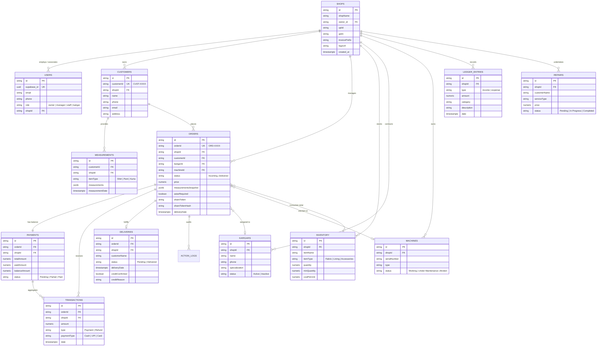

# 🗄️ StitchCraft — Database Architecture & Data Dictionary

---

## 1. Database Overview & Technology

The StitchCraft data architecture spans two persistent layers:
1. **Cloud Database (Supabase PostgreSQL)**: Serves as the authoritative multi-tenant backend store. Currently implemented via a hybrid JSONB document-store table (`public.app_records`) mediated by `config/supabaseModel.js`. A normalized relational schema is also provisioned in database migrations (`supabase/migrations/20261030150000_stitchcraft_schema.sql`) for SQL analytics and the planned relational cutover.
2. **Client Mobile Database (Encrypted SQLite)**: Serves as the offline-first operational store on Android and iOS devices. Implemented using `sqflite_sqlcipher` with per-device AES encryption keys stored in hardware-backed secure storage (`FlutterSecureStorage`).

---

## 2. Cloud Database Architecture (`app_records` & Hybrid Model)

### 2.1 The Document Adapter Strategy
Instead of standard Object-Relational Mapping (ORM) against fixed tabular columns, the active backend queries the `app_records` table:

```sql
create table if not exists public.app_records (
  collection text not null,
  source_id text not null,
  document jsonb not null default '{}'::jsonb,
  created_at timestamptz not null default now(),
  updated_at timestamptz not null default now(),
  primary key (collection, source_id)
);

create index if not exists app_records_collection_idx
  on public.app_records (collection);

create index if not exists app_records_document_gin_idx
  on public.app_records using gin (document);
```

### 2.2 Entity Collections in `app_records`
The backend model adapter (`config/supabaseModel.js`) registers 15 collections inside `app_records`:
1. `users` — User profiles, credentials reference, shop associations, and roles.
2. `shops` — Tailor shops, branch configuration, GSTIN, UPI IDs, invoice numbering prefix.
3. `customers` — Customer contact profiles, address, preferences.
4. `measurements` — Raw body measurements per customer/apparel type.
5. `orders` — Work orders, apparel specs, pricing, stage status, measurementsSnapshot.
6. `payments` — Order payment summaries (`totalAmount`, `paidAmount`, `balanceAmount`, `status`).
7. `transactions` — Append-only immutable payment and refund transactions.
8. `ledger_entries` — Shop income and expense journal entries for cash book calculations.
9. `inventory` — Fabric, astar, and accessory inventory counts and alert thresholds.
10. `karigars` — Artisan contact cards, specializations, piece rates, active status.
11. `machines` — Sewing and embroidery machines, serial numbers, maintenance status.
12. `deliveries` — Delivery handover logs, balance confirmation, credit approvals.
13. `notifications` — In-app notification alerts for shop team members.
14. `action_logs` — Audit trail for order status progressions.
15. `repairs` — Alteration and repair jobs, pricing, complexity, and status.

---

## 3. Entity Relationship Diagram (ERD)

The following Mermaid ER diagram illustrates the logical relationships between entities as enforced by the business logic, `shopId` scoping, and relational migrations:



---

## 4. Comprehensive Data Dictionary

### 4.1 `users`
| Column / JSON Key | Type | Constraints | Description | Sensitivity |
|---|---|---|---|---|
| `_id` / `id` | `TEXT` / `UUID` | Primary Key | Unique user document identifier | Internal ID |
| `supabase_id` | `UUID` | Unique, Not Null | Foreign key to Supabase `auth.users` | System ID |
| `name` | `TEXT` | Length >= 2 | Full name of shop user | PII |
| `email` | `TEXT` | RFC 5321 length <= 254 | Primary login email address | PII |
| `phone` | `TEXT` | 10–15 digits | Mobile contact number | PII |
| `role` | `TEXT` | Enum (`owner`, `manager`, `staff`, `karigar`) | Role within active shop | Security |
| `shopId` | `TEXT` | Foreign Key to `shops` | Currently active shop branch | Tenant Scope |
| `shops` | `ARRAY[JSONB]` | Array of memberships | List of shop branches user has access to | Multi-tenancy |

### 4.2 `shops`
| Column / JSON Key | Type | Constraints | Description | Sensitivity |
|---|---|---|---|---|
| `_id` / `id` | `TEXT` / `UUID` | Primary Key | Unique shop branch identifier | Tenant Scope |
| `shopName` | `TEXT` | Length >= 2, Not Null | Business trading name | Public |
| `owner_id` | `TEXT` | Foreign Key to `users` | Primary owner user identifier | Ownership |
| `phone` | `TEXT` | 10–15 digits | Shop contact phone number | Public / Business |
| `address` | `TEXT` | Optional string | Physical shop address | Business |
| `upiId` | `TEXT` | Valid VPA format (`user@bank`) | UPI Virtual Payment Address for customer payments | Financial |
| `gstin` | `TEXT` | Optional alphanumeric (15 chars) | Goods & Services Tax Identification Number | Business / Tax |
| `invoicePrefix`| `TEXT` | Defaults to `INV` | Prefix for human-readable invoice IDs | Business |
| `logoUrl` | `TEXT` | URL format | Signed storage URL for shop branding | Asset |

### 4.3 `customers`
| Column / JSON Key | Type | Constraints | Description | Sensitivity |
|---|---|---|---|---|
| `_id` / `id` | `TEXT` / `UUID` | Primary Key | Unique customer identifier | Internal ID |
| `customerId` | `TEXT` | Unique (`CUST-XXXXXXXX`) | Human-readable customer code | Reference |
| `shopId` | `TEXT` | Mandatory | Owning shop branch ID | Tenant Scope |
| `name` | `TEXT` | Length >= 2, Not Null | Customer's full name | PII |
| `phone` | `TEXT` | 10–15 digits, Indexed | Customer's WhatsApp/phone number | PII |
| `email` | `TEXT` | Optional valid email | Customer's email | PII |
| `address` | `TEXT` | Optional string | Residential / delivery address | PII |
| `measurements` | `JSONB` | Structured object | Latest measurement reference profile | Personal |

### 4.4 `orders`
| Column / JSON Key | Type | Constraints | Description | Sensitivity |
|---|---|---|---|---|
| `_id` / `id` | `TEXT` / `UUID` | Primary Key | Unique order identifier | Internal ID |
| `orderId` | `TEXT` | Unique (`ORD-XXXXXXXX`) | Human-readable order code | Reference |
| `shopId` | `TEXT` | Mandatory, Indexed | Owning shop branch ID | Tenant Scope |
| `customerId` | `TEXT` | Foreign Key to `customers` | Referencing customer ID | Relationship |
| `customerName` | `TEXT` | Denormalized string | Cached customer name for fast listing | PII |
| `apparelType` | `TEXT` | Enum (`Shirt`, `Pant`, `Kurta`, `Suit`, etc.) | Garment type | Operational |
| `status` | `TEXT` | Enum (`Incoming`, `Measuring`, `Cutting`, `Stitching`, `Checking`, `Ready`, `Delivered`, `Cancelled`) | Current workshop lifecycle state | Operational |
| `price` | `NUMERIC` | >= 0 | Total agreed stitching price (INR) | Financial |
| `measurementsSnapshot` | `JSONB` | Frozen object | Immutable snapshot of measurements at booking | Personal |
| `fabric` | `TEXT` | Optional description | Fabric details provided by customer | Operational |
| `fabricImageUrl`| `TEXT` | Optional Storage URL | Photo of fabric cloth pattern | Asset |
| `assignedKarigar`| `TEXT` | Foreign Key to `karigars` | Assigned artisan worker | Internal Staff |
| `assignedMachine`| `TEXT` | Foreign Key to `machines` | Assigned workshop machine | Internal Asset |
| `astarRequired`| `BOOLEAN` | Default false | Whether lining material must be deducted | Material |
| `astarDeducted`| `BOOLEAN` | Default false | Idempotency guard for stock deduction | Material Guard |
| `shareToken` | `TEXT` | Opaque base64url, Indexed | Secret guest invoice token | Security Token |
| `shareTokenHash`| `TEXT` | SHA-256 hash | Secure indexed lookup for guest token | Security Token |
| `shareTokenExpiresAt`| `TIMESTAMPTZ`| Default +30 days | Expiration deadline for guest link | Security |
| `shareTokenRevoked`| `BOOLEAN` | Default false | Instant invalidation flag | Security |
| `deliveryDate` | `TIMESTAMPTZ`| Delivery deadline | Target delivery commitment date | Operational |

### 4.5 `payments` & `transactions`
| Column / JSON Key | Type | Constraints | Description | Sensitivity |
|---|---|---|---|---|
| `payments._id` | `TEXT` | Primary Key | Payment balance record ID | Financial |
| `payments.orderId`| `TEXT` | Foreign Key to `orders` | Associated order | Financial |
| `payments.totalAmount`| `NUMERIC`| >= 0 | Total billable amount | Financial |
| `payments.paidAmount`| `NUMERIC`| >= 0 | Recomputed sum of transactions | Financial |
| `payments.balanceAmount`| `NUMERIC`| >= 0 | Outstanding balance due (Udhar) | Financial |
| `payments.status` | `TEXT` | Enum (`Pending`, `Partial`, `Paid`) | Recomputed settlement status | Financial |
| `transactions._id`| `TEXT` | Primary Key | Immutable transaction ID | Financial Audit |
| `transactions.orderId`| `TEXT`| Foreign Key to `orders` | Referencing order | Financial Audit |
| `transactions.amount`| `NUMERIC`| > 0 | Transaction monetary value | Financial Audit |
| `transactions.type`| `TEXT` | Enum (`Payment`, `Refund`) | Direction of cash flow | Financial Audit |
| `transactions.paymentType`| `TEXT`| Enum (`Cash`, `UPI`, `Card`, `NetBanking`) | Tender instrument used | Financial Audit |

---

## 5. Local Database Architecture (Flutter Mobile SQLite)

The mobile client stores data locally in SQLite using `sqflite_sqlcipher 3.0.1`.

### 5.1 Tables Created on Device
1. `shop` — Local shop branch cache.
2. `users` — Authenticated user profile and cached roles.
3. `customers` — Customer directory with soft preferences and phone numbers.
4. `measurements` — Measurement sets per customer.
5. `orders` — Active and completed orders with delivery deadlines and financial summaries.
6. `expenses` — Local cash book entries (type: `income` or `expense`).
7. `inventory` — Local inventory stock levels and alert thresholds.
8. `repair_jobs` — Alteration/repair tasks.
9. `lining_items` — Order-specific lining requirements.
10. `gallery_items` — Style catalogs and design reference photos.
11. `shop_settings` — Device-level preferences and active shop configurations.
12. `order_payments` — Local payment records.
13. `mutation_outbox` — Durable offline mutation queue for background synchronization.

### 5.2 Outbox Schema (`mutation_outbox`)
```sql
CREATE TABLE IF NOT EXISTS mutation_outbox (
  id TEXT PRIMARY KEY,
  table_name TEXT NOT NULL,
  action TEXT NOT NULL,          -- 'create' | 'update' | 'delete' | 'payment'
  record_id TEXT NOT NULL,
  idempotency_key TEXT NOT NULL UNIQUE,
  payload TEXT NOT NULL,         -- Serialized JSON
  status TEXT DEFAULT 'pending', -- 'pending' | 'success' | 'failed'
  retry_count INTEGER DEFAULT 0,
  max_retries INTEGER DEFAULT 5,
  last_error TEXT,
  conflict_state TEXT,
  created_at INTEGER NOT NULL,
  updated_at INTEGER NOT NULL
);
```

### 5.3 Encryption & Security
- **Algorithm**: AES-256 CBC encryption via SQLCipher.
- **Key Generation**: A 256-bit cryptographically secure pseudorandom key is generated on the first run of the app.
- **Key Storage**: Persisted in `FlutterSecureStorage` (backed by Android Keystore on Android and Apple Keychain on iOS).
- **Protection**: If the device is stolen or the storage is extracted via ADB, the raw SQLite file cannot be read without the hardware-backed keystore key.

---

## 6. Migration Strategy & Relational Cutover Plan

The repository contains an automated migration script: [`stitchcraft-backend/scripts/migrate_to_relational.js`](file:///home/manthan/Projects/StitchCraft/stitchcraft-backend/scripts/migrate_to_relational.js).

### 6.1 Migration Mechanism
1. Connects to Supabase PostgreSQL using the service-role key.
2. Reads all records from `public.app_records` batch-by-batch.
3. Extracts JSONB fields (`shopId`, `customerId`, `orderId`, `price`, `status`, etc.) into strongly-typed relational columns defined in [`supabase/migrations/20261030150000_stitchcraft_schema.sql`](file:///home/manthan/Projects/StitchCraft/supabase/migrations/20261030150000_stitchcraft_schema.sql).
4. Inserts transformed rows into dedicated relational domain tables (`public.orders`, `public.customers`, `public.payments`, etc.) while retaining the complete raw JSON in a `document` column for backward compatibility.
5. Safe and idempotent: Uses `ON CONFLICT (id) DO UPDATE`.

### 6.2 Architectural Risks & Mitigation
- **Risk 1 (Dual-Write Desynchronization)**: If relational tables are written by reporting tools while the backend API continues writing to `app_records`, data will diverge.
  *Mitigation*: The cutover must switch the backend model adapter (`config/supabaseModel.js`) to query the domain table directly (`supabase.from(collection)`).
- **Risk 2 (In-Memory Pagination & Sorting)**: `supabaseModel.js` currently loads all shop records and sorts/limits in memory.
  *Mitigation*: Relational cutover enables true SQL-level `.order('created_at', { ascending: false }).range(start, end)` pagination, eliminating backend memory bloat as shop volume grows.

