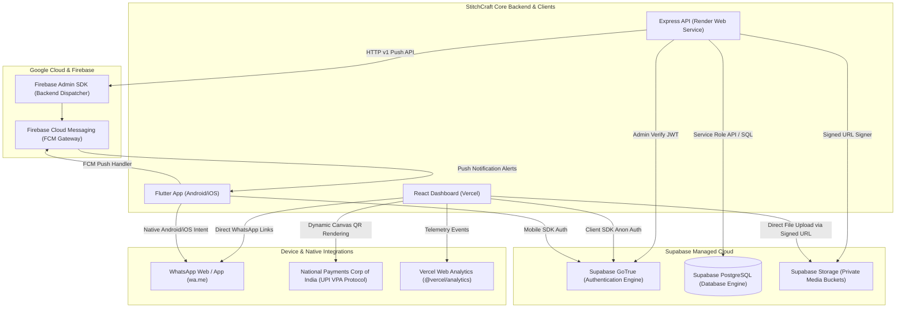

# 🔌 StitchCraft — Integrations, Environment Configuration & Deployment Architecture

---

## 1. External Services & Cloud Integrations

StitchCraft leverages managed third-party cloud infrastructure to minimize self-hosted maintenance overhead while maximizing operational uptime.



---

## 2. Integration Catalog & Technical Specifications

### 2.1 Supabase Authentication (GoTrue)
- **Component Using It**: Backend API (`middleware/authMiddleware.js`), Web Frontend (`context/AuthContext.jsx`), Mobile Client (`services/auth_service.dart`).
- **Protocol / SDK**: HTTPS REST via `@supabase/supabase-js 2.108.2` and `supabase_flutter 2.16.0`.
- **Authentication Method**: JWT Bearer Tokens. Users log in directly against Supabase GoTrue; the resulting JWT is forwarded in the `Authorization: Bearer <token>` header to the Express API.
- **Backend Verification**: `authMiddleware.js:20-30` invokes `supabase.auth.getUser(token)`. The user identity is verified server-side, eliminating trust in forged client tokens.
- **Failure Behavior**: If Supabase Auth is unreachable, API requests return HTTP 401; mobile app utilizes cached session tokens until expiration.

### 2.2 Supabase PostgreSQL Database
- **Component Using It**: Backend API (`config/supabase.js`, `config/supabaseModel.js`).
- **Connection Method**: Service-Role REST API (`SUPABASE_SERVICE_ROLE_KEY`) over HTTPS PostgREST.
- **Security Boundary**: The backend uses the administrative service-role key, which bypasses Row Level Security (RLS) on PostgreSQL. Tenant isolation is enforced logically in the API layer (`shopId: req.user.shopId`). Direct client access to PostgreSQL tables remains restricted.

### 2.3 Supabase Storage (Private Buckets)
- **Buckets Configured**: `profile-images` (Private), `maap-images` (Private).
- **Mechanism**: Zero public bucket exposure. Clients never upload directly with global write permissions. Instead:
  1. Client requests an upload token: `POST /api/upload/get-upload-url`.
  2. Backend validates active shop membership and generates a time-bounded signed upload URL via `supabase.storage.from(bucket).createSignedUploadUrl(path)`.
  3. Client uploads the binary payload directly to Supabase Storage via standard HTTP `PUT`.
  4. Viewing images requires generating signed viewing URLs via `GET /api/upload/view-url/:bucket/:path`.

### 2.4 Firebase Cloud Messaging (FCM)
- **Component Using It**: Backend API (`services/notificationService.js`), Mobile Client (`notification_service.dart`).
- **Backend SDK**: `firebase-admin 14.5.0`.
- **Mobile SDK**: `firebase_messaging 16.1.1`, `flutter_local_notifications 18.0.1`.
- **Graceful Fallback Mode**: If `FIREBASE_SERVICE_ACCOUNT` is not configured in the backend environment, the service catches the absence gracefully, skips push dispatch, and safely persists in-app alerts without throwing unhandled exceptions.
- **Push Eligibility Rules**: Routine events (order stage progression) trigger in-app notifications only. High-priority events (orders due within 24 hours, fabric stock below alert threshold) authorize immediate push dispatch.

### 2.5 WhatsApp Deep-Link Integration
- **Component Using It**: Web Dashboard (`PendingBalancesTab.jsx`), Mobile Client (`whatsapp_service.dart`).
- **Protocol**: Standard WhatsApp URL scheme (`https://wa.me/<phone>?text=<encoded_text>`).
- **No Third-Party Cost**: Does not require an expensive Meta WhatsApp Business Cloud API subscription. Uses native deep-linking to launch the tailor's WhatsApp app or WhatsApp Web directly on the device with pre-composed messages.

### 2.6 Dynamic UPI Settlement Protocol
- **Component Using It**: Web Dashboard (`PublicInvoice.jsx`), Mobile Client (`invoice_details_screen.dart`).
- **Standard**: National Payments Corporation of India (NPCI) UPI Deep Linking Spec:
  `upi://pay?pa=<shop.upiId>&pn=<shop.name>&am=<balanceAmount>&cu=INR&tn=Order-<orderId>`
- **Rendering**: Generates high-density QR codes rendered dynamically in browser canvases, scannable by Google Pay, PhonePe, Paytm, BHIM, or any Indian mobile banking application.

---

## 3. Environment Variable Reference

> [!IMPORTANT]
> **Security Policy Compliance**: No actual production secrets, passwords, or live tokens are exposed in this document. Below is the technical specification of expected environment keys.

### 3.1 Backend Environment Variables (`stitchcraft-backend/.env`)

| Variable Name | Required / Optional | Public / Secret | Description & Format |
|---|:---:|:---:|---|
| `PORT` | Optional (Default: 5000) | Public | Port on which the Express server listens. |
| `NODE_ENV` | Required | Public | Runtime mode (`development` or `production`). |
| `SUPABASE_URL` | **Required** | Public | The HTTPS endpoint URL for the Supabase project instance (`https://<project-ref>.supabase.co`). |
| `SUPABASE_SERVICE_ROLE_KEY` | **Required** | **Secret** | Supabase administrative service-role secret key. Bypasses RLS. Never commit to source code. |
| `CLIENT_URL` | Required | Public | Allowed web frontend origin for CORS policies (e.g. `http://localhost:5173` or `https://stitchcraft.vercel.app`). |
| `FIREBASE_SERVICE_ACCOUNT` | Optional | **Secret** | Serialized JSON string of the Google Cloud Firebase Service Account credential key. Enables FCM push. |

### 3.2 Web Frontend Environment Variables (`stitchcraft-frontend/.env`)

| Variable Name | Required / Optional | Public / Secret | Description & Format |
|---|:---:|:---:|---|
| `VITE_API_URL` | **Required** | Public | Target Express REST API base endpoint (e.g. `http://localhost:5000/api` or `https://stitchcraft-backend.onrender.com/api`). |
| `VITE_SUPABASE_URL` | **Required** | Public | Supabase project URL for client-side authentication and media storage. |
| `VITE_SUPABASE_ANON_KEY` | **Required** | Public (Anon) | Supabase anonymous/publishable public client key. Safe for browser bundling. |

### 3.3 Mobile Environment Configuration (`stitchcraft-mobile/env/dev.json`)

| Variable Name | Required / Optional | Public / Secret | Description & Format |
|---|:---:|:---:|---|
| `BACKEND_API_URL` | **Required** | Public | Target API base URL. Use `http://10.0.2.2:5000/api` for Android Emulator local dev; requires `https://` in production. |
| `SUPABASE_URL` | **Required** | Public | Supabase project URL for mobile auth client. |
| `SUPABASE_ANON_KEY` | **Required** | Public (Anon) | Supabase public publishable client key. |

---

## 4. Hosting & Deployment Specifications

### 4.1 Backend Deployment (Render)
Configured via repository root [`render.yaml`](file:///home/manthan/Projects/StitchCraft/render.yaml):
- **Plan / Environment**: Node.js Web Service on native Linux runtime.
- **Build Command**: `cd stitchcraft-backend && npm ci`
- **Start Command**: `node server.js`
- **Health Check Path**: `/api/status`
- **Port Matching**: Automatic port allocation bound via `process.env.PORT`.

### 4.2 Web Dashboard Deployment (Vercel)
Configured via repository root [`vercel.json`](file:///home/manthan/Projects/StitchCraft/vercel.json) and frontend [`stitchcraft-frontend/vercel.json`](file:///home/manthan/Projects/StitchCraft/stitchcraft-frontend/vercel.json):
- **Build Command**: `cd stitchcraft-frontend && npm install && npm run build`
- **Output Directory**: `stitchcraft-frontend/dist`
- **Framework**: Vite SPA.
- **SPA Route Rewriting**: Configured with a root catch-all rewrite (`"source": "/(.*)", "destination": "/index.html"`) ensuring that direct client-side deep navigation and browser refreshes work seamlessly for nested routes such as `/dashboard`, `/orders`, `/deliveries`, and guest invoice links `/invoice/share/:token`.
- **CORS & Origin Configuration**: Backend validates requesting origins against `CLIENT_URL` and `ALLOWED_ORIGINS` environment variables, automatically rejecting unconfigured origins by default in production while allowing local development ports (`localhost`, `127.0.0.1`, LAN IPs) in non-production.
- **Cache Invalidation**: `ignoreCommand` ensures builds trigger only when modifications touch `stitchcraft-frontend/`.

### 4.3 Mobile Build & Release Signing (Android)
- **Gradle Configuration**: `stitchcraft-mobile/android/app/build.gradle`.
- **Release Guard**: Release builds require production signing keys defined in `android/key.properties`:
  ```properties
  storePassword=***
  keyPassword=***
  keyAlias=***
  storeFile=/path/to/keystore.jks
  ```
  The build intentionally fails rather than falling back to debug keys if `key.properties` is omitted.
- **Build Commands**:
  - `flutter build apk --release --dart-define-from-file=env/prod.json`
  - `flutter build appbundle --release --dart-define-from-file=env/prod.json`

---

## 5. Continuous Integration (CI/CD) Pipeline

Automated pull request and push verification is configured in [`.github/workflows/ci.yml`](file:///home/manthan/Projects/StitchCraft/.github/workflows/ci.yml) and [`.github/workflows/codeql.yml`](file:///home/manthan/Projects/StitchCraft/.github/workflows/codeql.yml).

### 5.1 CI Gates & Execution Steps
1. **Backend Verification Job**:
   - Node.js version matrix: `22.x`.
   - Syntax validation: `find . -name node_modules -prune -o -type f -name '*.js' -print0 | xargs -0 -n1 node --check`.
   - Automated tests: `npm test` executing 57 automated tests across 18 test suites.
2. **Frontend Verification Job**:
   - Linting check: `npm run lint` (ESLint across all React components).
   - Formatter & validator tests: `npm test` (18 unit tests).
   - Production bundle compilation: `npm run build` validating zero build breakages.
3. **Mobile Verification Job**:
   - Flutter Action: `subosito/flutter-action@v2` targeting stable channel.
   - Analysis: `flutter analyze` ensuring zero static analyzer errors.
   - Tests: `flutter test` executing widget and theme unit tests.
4. **CodeQL Security Analysis**:
   - Scans JavaScript/TypeScript codebases for security vulnerabilities, injection flaws, and unsafe dependencies.
   - Zero open alerts currently verified.

