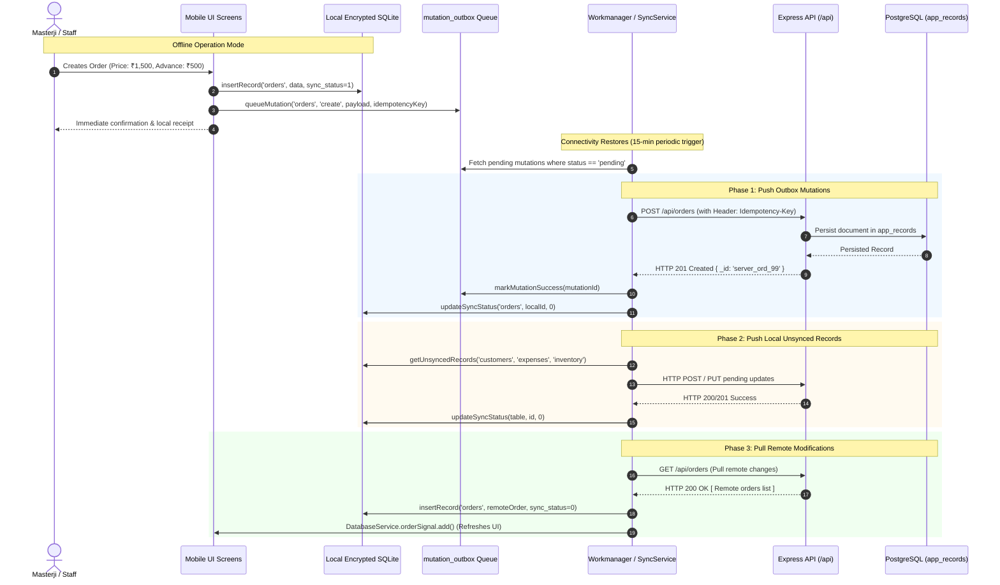

# 🔄 StitchCraft — Offline-First Architecture & Data Synchronization Audit

---

## 1. Offline-First Philosophy & Design Goals

Tailor shops in India frequently operate in basement markets, semi-urban localities, or dense commercial bazaars characterized by intermittent cellular connectivity, power outages, and high network latency.

The StitchCraft mobile application is architected around a **Local-First principle**:
1. **Zero UI Latency**: All user actions (creating a customer, taking measurements, booking an order, logging a payment) write directly to an on-device encrypted SQLite database. Screens never block on network roundtrips.
2. **Autonomous Offline Operation**: A masterji can operate for hours or days without an internet connection.
3. **Loss-Aware Synchronization**: When connectivity resumes, local mutations are pushed to the cloud and remote updates are pulled down, with durable error tracking and conflict isolation.

---

## 2. On-Device Storage Layer (SQLCipher SQLite)

### 2.1 Database Configuration & Encryption
- **Package**: `sqflite_sqlcipher 3.0.1`.
- **Database Engine**: Native SQLite with 256-bit AES cipher encryption.
- **Foreign Key Enforcement**: `PRAGMA foreign_keys = ON;` is executed on every database connection open in [`lib/core/services/local_db_service.dart:180`](file:///home/manthan/Projects/StitchCraft/stitchcraft-mobile/lib/core/services/local_db_service.dart#L180).
- **Key Storage**: The 256-bit passphrase is generated once using a cryptographically secure random number generator and saved to `FlutterSecureStorage` (backed by Android Keystore on Android and Apple Keychain on iOS).

### 2.2 Local Schema Inventory
The local database registers 13 tables defined in [`lib/core/config/database_tables.dart`](file:///home/manthan/Projects/StitchCraft/stitchcraft-mobile/lib/core/config/database_tables.dart):
1. `customers` — Customer contact info, preferences, and loyalty data.
2. `measurements` — Garment measurement attributes linked to customers.
3. `orders` — Active orders, prices, due dates, apparel types, and delivery statuses.
4. `expenses` — Cash book records (income and expense entries).
5. `inventory` — Local stock counts, unit costs, and low-stock alerts.
6. `order_payments` — Order payment transactions recorded locally.
7. `repair_jobs` — Alteration tasks.
8. `lining_items` — Order-level lining fabric assignments.
9. `gallery_items` — Style photo references.
10. `shop` — Active shop profile details.
11. `users` — Current user profile and credentials cache.
12. `shop_settings` — Device-level preferences.
13. `mutation_outbox` — Durable transactional mutation queue.

---

## 3. Synchronization Lifecycle Architecture



---

## 4. State Tracking & Mutation Outbox

### 4.1 Local `sync_status` Flags
Every local table row tracks its synchronization state via an integer flag:
- `0`: **Synced** — Identical to server record.
- `1`: **Pending Create** — Created locally while offline; pending initial server push.
- `2`: **Pending Delete** — Soft-deleted locally; pending server `DELETE` call before physical SQLite removal.
- `3`: **Pending Update** — Modified locally; pending server `PUT` call.
- `4`: **Validation Error** — Server rejected payload (e.g. invalid phone number); flagged for user correction.

### 4.2 Durable Mutation Outbox (`mutation_outbox`)
In addition to table-level `sync_status` flags, high-value mutations (payments, status progressions, stock adjustments) are captured in the transactional `mutation_outbox` table.
- **Idempotency Key**: Each mutation generates a unique key (e.g. `pay_ord_123_1730000000`). If a network connection drops mid-flight and the client retries, the backend detects the duplicate `Idempotency-Key` and returns the existing result without executing a second debit or credit.
- **Exponential Backoff**: Failed mutations increment `retry_count`. If a failure is permanent (HTTP 4xx validation error), it is marked terminal (`conflict_state = 'conflict'`) and surfaced in the `SyncStatusScreen` for manual review.

---

## 5. Conflict Resolution Strategy

| Conflict Scenario | Resolution Strategy | Implementation Mechanism |
|---|---|---|
| **Concurrent Customer Update** | Last-Write-Wins (Timestamp) | Evaluates `updated_at` millisecond timestamps; the newer record takes precedence. |
| **Duplicate Customer on Offline Creation** | Idempotency Key Deduping | Backend matches `idempotencyKey: cust_<id>` and updates existing record instead of creating duplicate. |
| **Payment Retry Duplicate** | Server-Side Idempotency Guard | Backend rejects repeat payment creation with identical key; returns existing transaction. |
| **Remote Pull vs Local Unsynced Edit** | Push-Before-Pull Priority | `SyncService.syncTable()` guarantees local pending changes are pushed **before** remote records are pulled. |
| **Local Soft Delete** | Deferred Physical Purge | Local row is marked `sync_status = 2`; permanently deleted from SQLite only after HTTP 200/204/404 from server. |

---

## 6. Critical Sync Audit Findings & Data Loss Risks

### 6.1 Finding 1: Tables Omitted from Synchronization Scope
- **Source Evidence**: [`stitchcraft-mobile/lib/core/services/sync_service.dart:45 & 246`](file:///home/manthan/Projects/StitchCraft/stitchcraft-mobile/lib/core/services/sync_service.dart#L45):
  ```dart
  final tables = ['customers', 'orders', 'expenses', 'inventory'];
  ```
- **Analysis**: The synchronization loop synchronizes **only 4 tables**.
- **Omitted Entities**:
  - `measurements` — Synchronized only indirectly if embedded inside an order payload (`measurementsSnapshot`). Standalone customer measurements taken without creating an immediate order are not synced to the cloud.
  - `karigars` — Mobile karigar directory is stored in SQLite but has no dedicated push/pull sync handler in `SyncService`.
  - `repair_jobs` — Stored locally in `repair_jobs`; not included in `syncAll()`.
  - `lining_items` and `gallery_items` — Local-only SQLite tables.
- **Severity**: **P1 - High**. Standalone measurements and karigars added on mobile will not appear on the web dashboard.

### 6.2 Finding 2: Potential Overwrite Risk on Push Failure
- **Source Evidence**: [`stitchcraft-mobile/lib/core/services/sync_service.dart:667`](file:///home/manthan/Projects/StitchCraft/stitchcraft-mobile/lib/core/services/sync_service.dart#L667) and [`local_db_service.dart:345`](file:///home/manthan/Projects/StitchCraft/stitchcraft-mobile/lib/core/services/local_db_service.dart#L345):
  ```dart
  await db!.insert(table, data, conflictAlgorithm: ConflictAlgorithm.replace);
  ```
- **Analysis**: If the Phase 1 push fails due to a network drop halfway through, the subsequent pull phase could execute `insertRecord` with `ConflictAlgorithm.replace`. If the remote server sends an older version of that record, it could theoretically overwrite the local offline edits.
- **Remediation**: Before executing `insertRecord` during a remote pull, the local database service must verify that `localRecord['sync_status'] == 0`. If `sync_status != 0`, the local modification must be preserved and flagged as a conflict.

