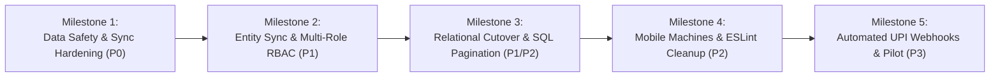

# 🚀 StitchCraft — Technical Improvement Roadmap & Remediation Plan

---

## 1. Roadmap Architecture & Phasing Strategy

This remediation plan organizes architectural upgrades and bug fixes into five shippable milestones, prioritizing zero data-loss, financial integrity, and workshop performance before introducing non-critical feature expansions.



---

## 2. Milestone 1: Data Safety, Conflict Resolution & Outbox Hardening (Priority 0)

### Task M1-01: Protect Local Offline Edits During Sync Pull Overwrite
- **Problem**: When `SyncService` pulls remote data, it inserts records using SQLite `ConflictAlgorithm.replace`. If a previous push failed due to network disruption, local offline modifications (`sync_status == 1` or `3`) could be overwritten by older server state.
- **Evidence**: [`stitchcraft-mobile/lib/core/services/sync_service.dart:667`](file:///home/manthan/Projects/StitchCraft/stitchcraft-mobile/lib/core/services/sync_service.dart#L667) and [`local_db_service.dart:345`](file:///home/manthan/Projects/StitchCraft/stitchcraft-mobile/lib/core/services/local_db_service.dart#L345).
- **Proposed Solution**:
  1. Modify `insertRecord()` or create a dedicated `upsertRemoteRecord()` helper.
  2. Inspect existing local row: if `existing.sync_status != 0`, do NOT replace the row.
  3. Flag the record in `mutation_outbox` with `conflict_state = 'conflict'` and log the remote version for user comparison.
- **Affected Files**: `stitchcraft-mobile/lib/core/services/sync_service.dart`, `local_db_service.dart`.
- **Database Migrations**: None.
- **Testing Requirements**: Add unit/integration test in mobile testing simulating offline edit followed by remote pull.
- **Estimated Complexity**: **Medium** (2–3 days).
- **Priority**: **P0 — Critical**.

---

## 3. Milestone 2: Multi-Role RBAC & Full Entity Synchronization (Priority 1)

### Task M2-01: Expand Mobile Background Sync to All Domain Tables
- **Problem**: Current mobile sync only syncs `customers`, `orders`, `expenses`, and `inventory`. Standalone customer measurements, karigars, and repair jobs are trapped on device.
- **Evidence**: [`stitchcraft-mobile/lib/core/services/sync_service.dart:45`](file:///home/manthan/Projects/StitchCraft/stitchcraft-mobile/lib/core/services/sync_service.dart#L45).
- **Proposed Solution**:
  1. Add `'measurements'` and `'karigars'` to the `tables` array in `SyncService.dart`.
  2. Implement `mapRecordToApiPayload` and `mapApiResponseToSqlite` converters for measurements and karigars.
  3. Ensure standalone measurements sync bidirectionally with the Web dashboard.
- **Affected Files**: `stitchcraft-mobile/lib/core/services/sync_service.dart`.
- **Testing Requirements**: Verify measurement created on mobile syncs to Supabase and renders on Web `CustomerDetails.jsx`.
- **Estimated Complexity**: **Medium** (2 days).
- **Priority**: **P1 — High**.

### Task M2-02: Fine-Grained Role-Based Access Control (RBAC) Enforcement
- **Problem**: `authMiddleware.js` enforces `owner` checks on sensitive endpoints, but general order/inventory write routes lack granular role filtering (e.g., karigars should only update job status, staff should not view financial margins).
- **Evidence**: [`stitchcraft-backend/middleware/authMiddleware.js:46-55`](file:///home/manthan/Projects/StitchCraft/stitchcraft-backend/middleware/authMiddleware.js#L46-L55), `orderController.js`.
- **Proposed Solution**:
  1. Implement field-level role policies in `orderController.updateOrder`: if `req.user.role === 'karigar'`, only allow updating `status` and `notes` on orders assigned to `req.user._id`.
  2. Mask fabric wholesale costs and shop profit summaries on all endpoints when requested by `staff` or `karigar`.
- **Affected Files**: `stitchcraft-backend/middleware/authMiddleware.js`, `controllers/orderController.js`, `controllers/inventoryController.js`.
- **Testing Requirements**: Unit tests asserting HTTP 403 when karigar attempts to update order price or view wholesale fabric rates.
- **Estimated Complexity**: **Medium** (3 days).
- **Priority**: **P1 — High**.

---

## 4. Milestone 3: Relational Schema Cutover & True SQL Pagination (Priority 1/2)

### Task M3-01: Relational Schema Cutover & Database Query Modernization
- **Problem**: `SupabaseModel` queries `public.app_records` JSONB table and performs sorting and pagination in Node.js heap memory (`values.sort()` and `values.slice()`), causing linear memory growth and latency bottlenecks as order history expands.
- **Evidence**: [`stitchcraft-backend/config/supabaseModel.js:131-147`](file:///home/manthan/Projects/StitchCraft/stitchcraft-backend/config/supabaseModel.js#L131-L147), [`scripts/migrate_to_relational.js`](file:///home/manthan/Projects/StitchCraft/stitchcraft-backend/scripts/migrate_to_relational.js).
- **Proposed Solution**:
  1. Execute `scripts/migrate_to_relational.js` against staging database to normalize documents into typed relational tables (`orders`, `customers`, `payments`, `inventory`).
  2. Update `supabaseModel.js` to target domain tables directly: `supabase.from(collection).select(...).order(...).range(...)`.
  3. Push limit and offset parameters to PostgreSQL SQL queries.
- **Affected Files**: `stitchcraft-backend/config/supabaseModel.js`, `scripts/migrate_to_relational.js`, `supabase/migrations/`.
- **Database Migrations**: Execute `20261030150000_stitchcraft_schema.sql` on production Supabase instance.
- **Testing Requirements**: Run `npm test` verifying all 57 backend tests pass without modification to business controller logic.
- **Estimated Complexity**: **High** (4–5 days).
- **Priority**: **P1 — High**.

---

## 5. Milestone 4: Mobile Machines Registry & Frontend Linter Cleanup (Priority 2)

### Task M4-01: Mobile Machines Registry Implementation
- **Problem**: Machine registry exists exclusively on the Web dashboard (`Machines.jsx`); the mobile app lacks a machines UI.
- **Evidence**: [`stitchcraft-mobile/lib/main.dart`](file:///home/manthan/Projects/StitchCraft/stitchcraft-mobile/lib/main.dart).
- **Proposed Solution**:
  1. Create `MachinesScreen` under `stitchcraft-mobile/lib/features/shop/screens/machines_screen.dart`.
  2. Implement machine status toggle card (`Working`, `Under Maintenance`, `Broken`).
  3. Register `/machines` in `lib/main.dart` and add navigation tile in `ShopHubScreen`.
- **Affected Files**: `stitchcraft-mobile/lib/features/shop/screens/machines_screen.dart`, `lib/main.dart`, `shop_hub_screen.dart`.
- **Estimated Complexity**: **Low** (1–2 days).
- **Priority**: **P2 — Medium**.

### Task M4-02: Resolve ESLint Warnings & Exhaustive Deps
- **Problem**: ESLint reports 14 warnings across React components, primarily missing dependencies in `useEffect` hooks and fast-refresh context export warnings.
- **Evidence**: `npm run lint` output in `stitchcraft-frontend/`.
- **Proposed Solution**:
  1. Wrap data-fetching functions (`fetchOrderDetails`, `fetchCustomerDetails`, `fetchDeliveries`, `fetchJournal`, `fetchPayments`) in `useCallback` hooks.
  2. Separate React context declarations from provider components into dedicated files.
  3. Remove unused error variables (`_e`, `_err`).
- **Affected Files**: `AuthContext.jsx`, `LanguageContext.jsx`, `ThemeContext.jsx`, `useOrderDetails.js`, `CustomerDetails.jsx`, `Delivery.jsx`, `EditOrder.jsx`, `KarigarDetails.jsx`, `Ledger.jsx`, `Payments.jsx`.
- **Testing Requirements**: `npm run lint` must exit with 0 errors and 0 warnings.
- **Estimated Complexity**: **Low** (1 day).
- **Priority**: **P2 — Medium**.

### Task M4-03: Add SPA Rewrites to `vercel.json`
- **Problem**: Direct browser reloads on deep web routes (e.g. `/orders/123`, `/invoice/share/token`) fail with 404 on Vercel unless rewrites are specified.
- **Evidence**: [`vercel.json`](file:///home/manthan/Projects/StitchCraft/vercel.json).
- **Proposed Solution**: Add SPA fallback rewrite rule to `vercel.json`:
  ```json
  "rewrites": [
    { "source": "/(.*)", "destination": "/index.html" }
  ]
  ```
- **Estimated Complexity**: **Low** (15 minutes).
- **Priority**: **P2 — Medium**.

---

## 6. Milestone 5: Automated Payment Gateway & Real Shop Pilot (Priority 3)

### Task M5-01: Automated UPI Dynamic Webhook Settlement
- **Problem**: UPI payment verification is currently manual.
- **Proposed Solution**: Integrate an optional automated UPI payment aggregator (Cashfree / Razorpay UPI Gateway) to listen for server-to-server webhook callbacks and automatically mark order payments as `Paid` upon bank confirmation.
- **Estimated Complexity**: **High** (4–5 days).
- **Priority**: **P3 — Low (Enhancement)**.

### Task M5-02: Tailor Shop Pilot Program (3–5 Real Tailors)
- **Objective**: Conduct a 14-day production trial with 3–5 real Indian tailor shops in commercial market environments.
- **Success Metrics**:
  - Zero measurement data loss across 500+ booked orders.
  - 100% successful background synchronization over 2G/3G/4G cellular connections.
  - Less than 5 seconds average order creation time on Android smartphones.
  - Udhar recovery rate increased by >= 30% through one-tap WhatsApp reminders.

