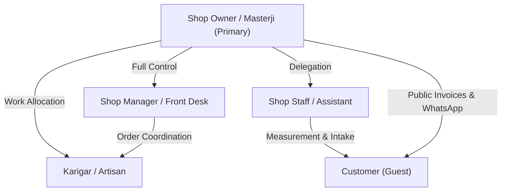

# 🧵 StitchCraft — Project Overview & Business Problem Statement

---

## 1. Executive Summary

**StitchCraft** is an offline-first, multi-tenant tailor shop Enterprise Resource Planning (ERP) platform architected specifically for Indian bespoke tailoring shops ("masterji" establishments) and designer boutiques. Bespoke tailoring in India is fundamentally distinct from standard retail apparel: it involves custom body measurements across multiple apparel categories (kameez, kurta, sherwani, trousers, blousy garments), multi-stage artisanal production workflows (measuring, cutting, stitching, trial, finishing, delivery), material consumption (fabric and internal lining/astar), piece-rate or salaried artisan (karigar) coordination, fragmented informal credit books (*khata* / *udhar*), and direct customer relationship management over WhatsApp and UPI.

The platform bridges modern cloud architecture with workshop-floor operational realities through a responsive web dashboard (React 19 / Vite 8), a cross-platform mobile application (Flutter / Dart / SQLCipher), and a hardened Express 5 backend connected to Supabase (PostgreSQL, Auth, Storage) and Firebase Cloud Messaging (FCM).

---

## 2. Real-World Problem Statement & Context

### 2.1 Why the Problem Exists
Traditional tailoring in Bharat operates on informal manual infrastructure:
1. **Physical "Maap" (Measurement) Books**: Tailor shops record measurements in paper diaries. Over years, paper degrades, pages tear, and finding a returning customer's measurements requires manually searching hundreds of handwritten pages.
2. **Multi-Stage Workshop Handoffs**: An order moves through sequential physical stages—Fabric Receipt → Measurement & Cutting → Karigar Allocation → Stitching → Ironing/Finishing → Customer Trial → Final Alteration → Delivery. Shop owners frequently lose visibility into which karigar holds which garment, causing missed delivery deadlines.
3. **Severe Credit / Udhar Leakage**: Indian tailors routinely collect a small advance (or no advance) and deliver finished garments on credit (*udhar*). Tracking who owes money across hundreds of customers relying on paper registers leads to uncollected balances, disputed amounts, and cash flow insolvency.
4. **Lining & Fabric Inventory Wastage**: Bespoke garments require internal lining material (*astar*). Inaccurate manual calculation of fabric consumption and missing inventory thresholds lead to stockouts during active stitching or untracked shrinkage/wastage.
5. **Customer Anxiety & Communication Overhead**: Customers repeatedly visit or call the shop to ask *"Masterji, kapda sil gaya kya?"* (Is my cloth stitched?). Tailors waste substantial daily productive hours answering repetitive status inquiries.
6. **Harsh Operational Constraints**: Masterjis work in noisy environments with chalk-covered hands, experience intermittent cellular/broadband connectivity, operate on shared low-cost Android smartphones, and communicate almost exclusively through WhatsApp and UPI rather than email or complex web forms.

### 2.2 How StitchCraft Addresses These Problems
- **Digital Measurement Vault with Snapshotting**: Stores body dimensions per garment type with historical tracking, audio voice note recording, and reference photo attachments. Snapshotting guarantees that alterations to a customer profile never corrupt past completed orders.
- **Visual Production Pipeline**: Real-time stage progression (`Incoming` → `Measuring` → `Cutting` → `Stitching` → `Checking` → `Ready` → `Delivered`) with karigar assignments and machine tracking.
- **Automated Khata & Udhar Recovery Engine**: Tracks customer balances, computes shop receivables dynamically, and formats one-tap WhatsApp payment reminder links with merchant UPI VPAs.
- **Automated Lining (Astar) Deduction**: Deducts lining material from inventory automatically upon entering active workshop stages (`Stitching`, `Checking`, `Ready`, `Delivered`) and restores stock if an order is cancelled.
- **Tokenized Public Guest Invoices**: Shareable guest links requiring zero customer login, stripping confidential workshop costs while rendering itemized balances and dynamic UPI payment QR codes.
- **Offline-First Resilience**: An AES-encrypted SQLite mobile database (`sqflite_sqlcipher`) enables order creation, measurement recording, and khata updates during network outages, syncing bi-directionally with the cloud when reconnected.

---

## 3. Product Differentiation

| Capability | Generic POS / Retail Billing | Generic ERP (e.g., Odoo/Tally) | StitchCraft Tailor ERP |
|---|---|---|---|
| **Measurement Handling** | None (SKU-based only) | Requires heavy custom modules | Built-in garment schemas (shirt, pant, kurta) with maap photo attachments |
| **Production Tracking** | None | Manufacturing work-orders | Artisanal stage transitions with karigar piece-rate tracking |
| **Material Consumption** | Standard BOM | Rigid MRP manufacturing | Dynamic astar (lining) auto-deduction with stage lifecycle integration |
| **Customer Payment Flow** | POS card/cash | Invoices via email/portal | One-tap WhatsApp reminders with dynamic UPI QR codes and Udhar ledger |
| **Workshop Environment** | Requires PC / POS terminal | Requires desktop browser | Offline-first mobile app with voice input for low-end Android devices |
| **Localization** | English only | Major international languages | Native English, Hindi, and Gujarati tri-lingual localization |

---

## 4. Target Audience & User Personas

### 4.1 Persona Matrix

#### 1. Shop Owner / Masterji (Primary Persona)
- **Profile**: Owner-operator of the shop. Highly experienced tailor with deep craft knowledge, limited typing speed, highly time-constrained.
- **Responsibilities**: Customer relationship, measurement taking, critical cutting, karigar oversight, financial health, cash collection.
- **Permissions**: Unrestricted access across all domains (finances, settings, staff delegation, data export, shop branch switching).
- **Key Features Used**: Daily dashboard, Udhar recovery tab, Order creation wizard, Khata ledger, Karigar settlements, Shop branding.

#### 2. Shop Manager
- **Profile**: Floor supervisor or front-desk coordinator in larger boutiques.
- **Responsibilities**: Day-to-day order booking, customer inquiries, delivery handovers, inventory stock monitoring.
- **Permissions**: Operational access to orders, customers, inventory, and delivery tracking. Blocked from owner-only actions (role changes, staff unlinking, account deletion, database wiping, shop deletion).

#### 3. Shop Staff
- **Profile**: Junior assistant handling measurement data entry, garment pressing, or customer reception.
- **Responsibilities**: Record customer contact details, look up order status, log physical handovers.
- **Permissions**: Read/write access to customer profiles and assigned orders. Blocked from financial ledgers, staff settings, and shop configuration.

#### 4. Karigar (Artisan / Worker)
- **Profile**: Specialized piece-rate or daily-wage worker (cutting master, trouser specialist, coat artisan).
- **Responsibilities**: Execute stitching according to specified measurements and delivery deadline.
- **Permissions**: Restricted to viewing assigned jobs and updating status (`Stitching` → `Ready`). No visibility into customer phone numbers, addresses, fabric wholesale costs, or shop profits.

#### 5. Customer (Guest)
- **Profile**: Individual getting bespoke clothes tailored.
- **Responsibilities**: Provide measurements, inspect trial fit, pay advance/balance.
- **Permissions**: Zero authenticated access. Interacts exclusively via tokenized public web links (`/invoice/share/:id`) to view status, itemization, and UPI payment QR code.

---

## 5. Role-Based Access Control (RBAC) Matrix

### 5.1 Documented vs. Implemented Permissions

The platform defines a four-role hierarchy (`owner`, `manager`, `staff`, `karigar`). Below is the verified implementation status comparing the architecture specification against actual source code enforcement (`stitchcraft-backend/middleware/authMiddleware.js:46-55`):

| Domain & Feature | Architecture Spec | Implemented Code Reality | Enforcement Mechanism |
|---|:---:|:---:|---|
| **View Dashboard Analytics** | Owner, Manager | Owner only | `dashboardRoutes.js` (Protected; user object must contain `shopId`) |
| **Create & Update Orders** | Owner, Manager, Staff | Owner, Manager, Staff | `orderRoutes.js:35-42` (`protect` middleware scopes by `shopId`) |
| **Customer Measurements** | Owner, Manager, Staff | Owner, Manager, Staff | `customerRoutes.js:22-29` (`protect` middleware scopes by `shopId`) |
| **Khata Ledger & Financial Summaries** | Owner, Manager | Owner only | `ledgerRoutes.js:18-20` (Accessible by authenticated users with shopId) |
| **Shop Expense Deletion** | Owner only | **Owner only** | `ledgerRoutes.js:23` (`authorize('owner')`) |
| **Staff Role Assignment & Unlinking** | Owner only | **Owner only** | `staffRoutes.js:16` (`authorize('owner')` on all staff routes) |
| **Inventory Stock Adjustments** | Owner, Manager | Owner, Manager | `inventoryRoutes.js:25` (`protect` middleware scopes by `shopId`) |
| **Public Guest Invoice** | Public (Guest) | **Public (Guest)** | `orderRoutes.js:31` (`publicInvoiceLimiter`, `validateShareTokenParam`) |
| **Account Deletion & Data Wipe** | Owner only | **Owner only** | `authRoutes.js:45-49` (`authorize('owner')`, `destructiveLimiter`) |
| **Shop Branch Deletion** | Owner only | **Owner only** | `shopRoutes.js:24` (`authorize('owner')`) |

> [!IMPORTANT]
> **Audit Finding (Role Enforcement Status)**: In `stitchcraft-backend/middleware/authMiddleware.js:46-55`, `authorize(...roles)` inspects `req.user.role`. On routes requiring `authorize('owner')` (Staff management, Expense deletion, Account wiping, Shop deletion), non-owners are strictly blocked with HTTP 403. However, general routes for inventory, customers, and orders rely solely on `protect`, meaning any user with a valid shop token can read/write those collections until fine-grained field-level authorization policies are applied.

---

## 6. Project Requirements Baseline

### 6.1 Functional Requirements
1. **Multi-Tenancy & Shop Scoping**: Every operational record must carry a mandatory `shopId`. Users must be able to switch active shop contexts dynamically via `/api/auth/switch-shop/:id`.
2. **Customer & Measurement Lifecycle**: Store customer profiles with phone validation (10–15 digits) and maintain a snapshot of measurements upon order creation to ensure historical accuracy.
3. **8-Stage Production Lifecycle**: Track garments through `Incoming`, `Measuring`, `Cutting`, `Stitching`, `Checking`, `Ready`, `Delivered`, and `Cancelled`.
4. **Idempotent Financial Ledger**: Orders and payments must maintain mathematical integrity (`totalAmount = paidAmount + balanceAmount`). Payments must produce immutable transaction records.
5. **Udhar (Credit) Management**: Automatically aggregate outstanding receivables across customers and format pre-filled WhatsApp reminder messages.
6. **Lining (Astar) Stock Automation**: Deduct material upon active stitching stages and restore stock upon order cancellation.
7. **Public Guest Invoices**: Token-gated public receipts with dynamic UPI QR code rendering that strip all internal wholesale costs and artisan notes.
8. **Multi-Language Support**: Complete UI localization across English, Hindi, and Gujarati on both Web and Mobile.

### 6.2 Non-Functional Requirements
1. **Offline Operation**: The mobile client must support local reading and writing of customers, orders, inventory, and expenses during network disconnects.
2. **Data Security**: At-rest database encryption on mobile devices using AES (`sqflite_sqlcipher`) and secure session management via Supabase Auth.
3. **ReDoS Resistance**: Deterministic, linear regular expressions for all email and phone validation to prevent Denial of Service attacks.
4. **Rate Limiting**: Multi-tiered protection across general API endpoints (300 req / 15 min), auth routes (10 req / 15 min), media uploads (30 req / 15 min), and destructive operations (10 req / 15 min).
5. **Zero Data Loss on Sync**: Remote synchronization must never silently drop local offline modifications or overwrite un-synced customer records.

---

## 7. Assumptions & Current Constraints

1. **PostgreSQL Storage Layer**: Production data currently resides in a document-store table `public.app_records` storing JSONB payloads via `config/supabaseModel.js`. Normalized typed relational tables exist in migrations (`supabase/migrations/20261030150000_stitchcraft_schema.sql`) and a migration script is provided (`scripts/migrate_to_relational.js`), but active controllers still write through the JSONB adapter.
2. **Payment Gateway Integration**: Payment tracking is purely ledger-based. The application generates UPI payment links (`upi://pay?pa=...`) and QR codes, but does not integrate an automated bank webhook (e.g., Razorpay/Cashfree) for automated transaction settlement. The masterji manually marks the payment as received.
3. **Push Notification Infrastructure**: Firebase Cloud Messaging (FCM) is integrated on the backend (`services/notificationService.js`) and mobile (`notification_service.dart`), but runs in graceful fallback mode if Google Service Account credentials are not supplied in the environment.
4. **Mobile Platform Target**: Full offline SQLite persistence is supported on Android and iOS. The web build of the mobile app uses an in-memory compatibility store that does not persist across browser reloads.

