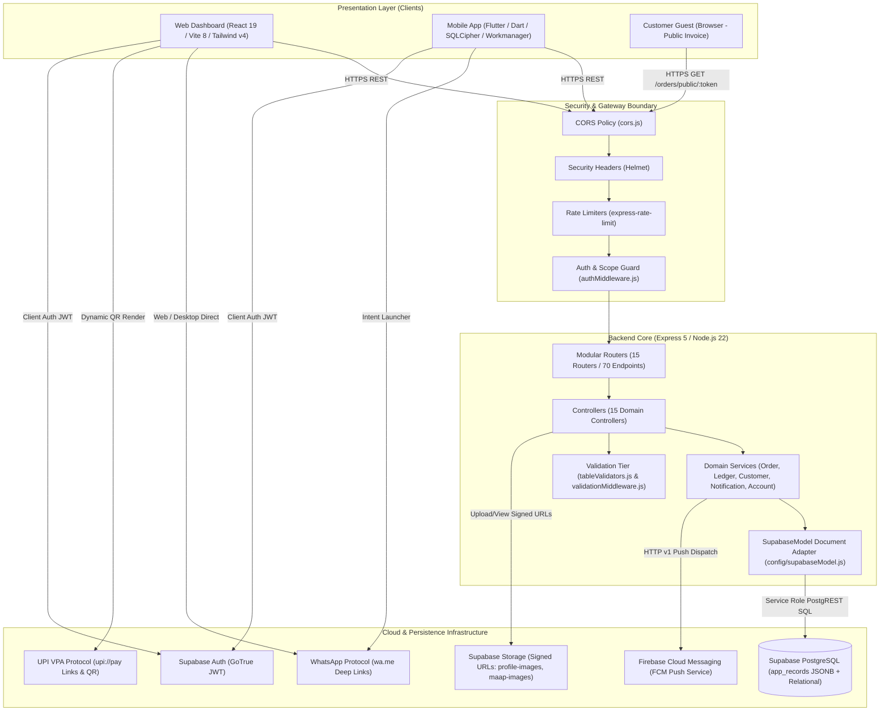
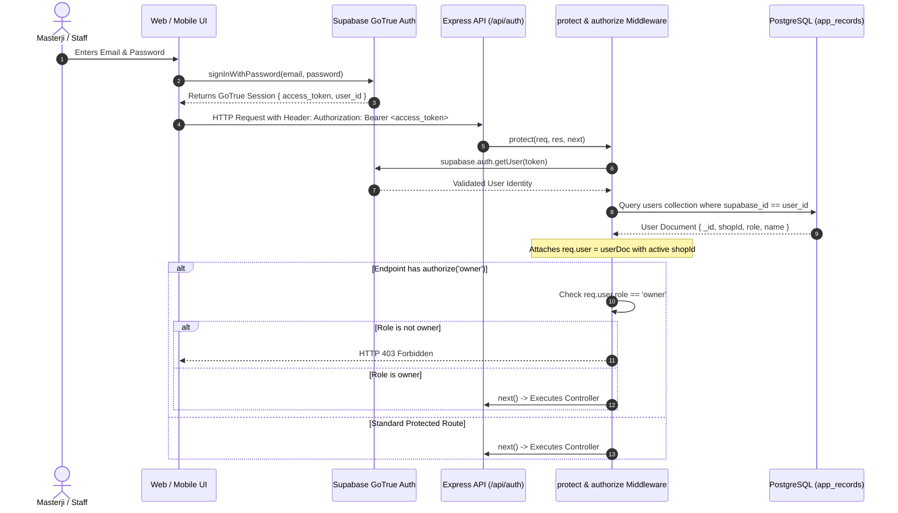
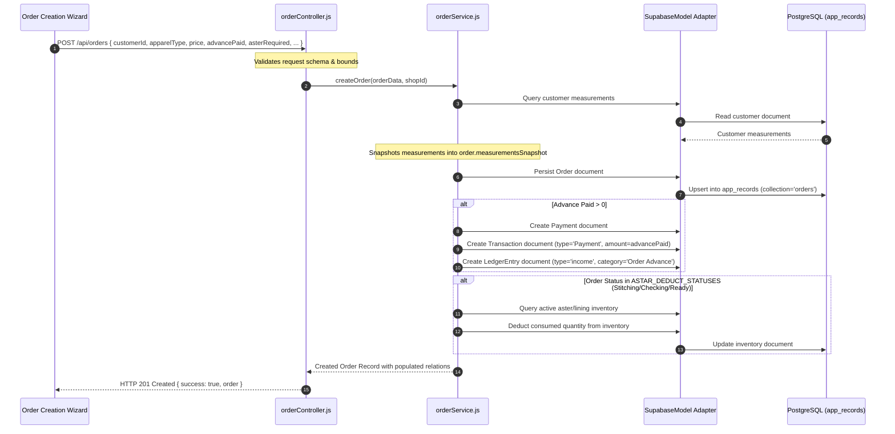
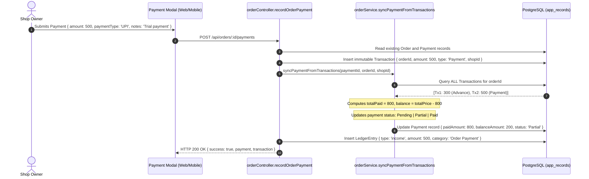
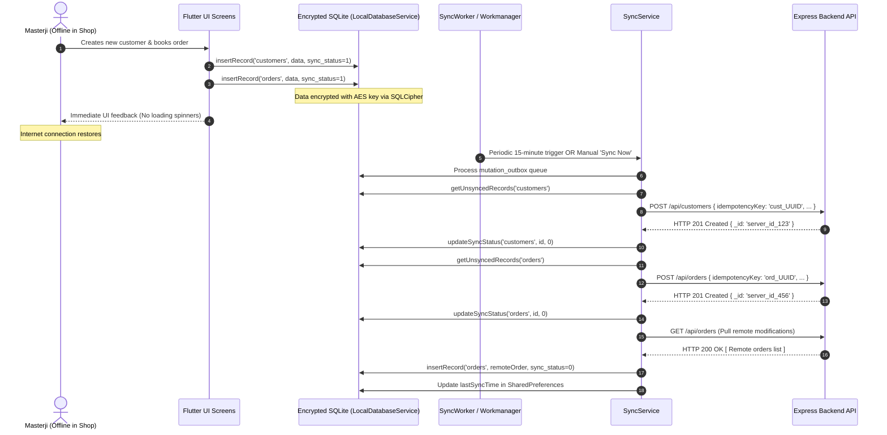

# 🏛️ StitchCraft — System Architecture Specification

---

## 1. High-Level Architecture Topology

StitchCraft employs a distributed multi-tier architecture consisting of two client presentation applications (React Web Dashboard and Flutter Mobile App), a hardened Express 5 API gateway, and cloud infrastructure hosted on Supabase and Firebase.



---

## 2. Core Architectural Patterns

1. **Multi-Tenant Scoped Architecture**: Tenant partitioning is enforced logically at the query level using `shopId`. Every request authenticated by `protect` middleware resolves the user's active `shopId` (`req.user.shopId`), which is injected into all subsequent database queries and writes.
2. **Document-to-Table Model Adapter Pattern (`config/supabaseModel.js`)**: An abstraction layer that emulates document-database interfaces (`find`, `findOne`, `findById`, `save`, `populate`, `sort`, `limit`) over a single Supabase PostgreSQL table (`app_records`) storing JSONB documents with GIN indexing.
3. **Local-First Mobile Architecture**: The Flutter client persists data to an encrypted on-device SQLite database (`LocalDatabaseService` using `sqflite_sqlcipher`). Operations execute locally with zero network latency; an asynchronous outbox worker (`SyncService` / `workmanager`) reconciles pending mutations with the backend REST API.
4. **Three-Tier Validation Pipeline**: Input sanitization and bounds checking occur at the client UI (`formValidators.js`), HTTP middleware boundary (`validationMiddleware.js`), and database model layer (`tableValidators.js`).
5. **Immutable Financial Transaction Ledger**: Payments are never modified in place. Every monetary exchange records an append-only `Transaction` document, from which parent `Payment` balances (`paidAmount`, `balanceAmount`, `status`) are deterministically recomputed.

---

## 3. Detailed Component Decomposition

### 3.1 Backend Service (`stitchcraft-backend/`)
- **Technology**: Node.js `22.x`, Express.js `5.2.1` (ESM module format).
- **Entry Point**: [`server.js`](file:///home/manthan/Projects/StitchCraft/stitchcraft-backend/server.js).
- **Responsibilities**: Authentication verification, multi-tenant scoping, business logic execution (order lifecycle, material deductions, financial math, udhar aggregation), input validation, rate limiting, and push dispatch.
- **Dependencies**: `@supabase/supabase-js`, `express`, `express-rate-limit`, `helmet`, `cors`, `firebase-admin`, `dotenv`.
- **Deployment Location**: Render Web Service (configured via [`render.yaml`](file:///home/manthan/Projects/StitchCraft/render.yaml)).
- **Failure Impact**: Complete loss of cloud synchronization, web dashboard access, and public invoice rendering. Mobile clients continue operating offline on cached SQLite data.

### 3.2 Web Dashboard (`stitchcraft-frontend/`)
- **Technology**: React `19.3.1`, Vite `8.3.5`, TailwindCSS `v4.3.3`, React Router DOM `v7.18.5`.
- **Entry Point**: [`src/main.jsx`](file:///home/manthan/Projects/StitchCraft/stitchcraft-frontend/src/main.jsx) and [`src/App.jsx`](file:///home/manthan/Projects/StitchCraft/stitchcraft-frontend/src/App.jsx).
- **Responsibilities**: Full administrative workspace, real-time analytics, staff delegation, workshop Kanban tracking, customer measurement logging, PDF printing, and public invoice viewing.
- **Dependencies**: `@supabase/supabase-js`, `@vercel/analytics`, `react-icons`, `tailwindcss`.
- **Deployment Location**: Vercel (configured via [`vercel.json`](file:///home/manthan/Projects/StitchCraft/vercel.json)).
- **Failure Impact**: Administrative users cannot access dashboard via browser; mobile client remains functional.

### 3.3 Mobile Application (`stitchcraft-mobile/`)
- **Technology**: Flutter SDK (Dart `^3.10.7`), SQLCipher SQLite, Workmanager.
- **Entry Point**: [`lib/main.dart`](file:///home/manthan/Projects/StitchCraft/stitchcraft-mobile/lib/main.dart).
- **Responsibilities**: Workshop-floor order booking, 5-step order creation wizard with voice input, camera maap capture, offline khata ledger, WhatsApp messaging, and periodic background synchronization.
- **Dependencies**: `sqflite_sqlcipher`, `workmanager`, `supabase_flutter`, `http`, `firebase_messaging`, `flutter_local_notifications`, `pdf`, `printing`, `url_launcher`, `provider`.
- **Deployment Target**: Android APK / AppBundle (API 21+) and iOS Runner.
- **Failure Impact**: Isolated to single physical device; server and web dashboard unaffected.

---

## 4. Architectural Flows & Diagrams

### 4.1 Authentication & Authorization Flow



### 4.2 Order Creation & Material Consumption Data Flow



### 4.3 Immutable Payment & Khata Ledger Flow



### 4.4 Mobile Offline Synchronization Flow



### 4.5 Notification & Push Dispatch Architecture

```mermaid
sequenceDiagram
    autonumber
    participant Event as System Trigger (Order Due / Low Stock)
    participant NotifSvc as notificationService.js
    participant DB as PostgreSQL (notifications collection)
    participant FCMAdmin as Firebase Admin SDK
    participant GoogleFCM as Firebase Cloud Messaging
    participant MobileClient as Flutter Device (firebase_messaging)

    Event->>NotifSvc: dispatchNotification(shopId, { title, message, type, recipientRoles })
    NotifSvc->>DB: Persist in-app notification document { read: false, shopId }
    
    alt Notification Type in PUSH_AUTHORIZED_TYPES (Order Due / Low Stock)
        NotifSvc->>DB: Query device tokens for shop users
        DB-->>NotifSvc: [ FCM Registration Tokens ]
        alt Firebase Admin Credentials Configured
            NotifSvc->>FCMAdmin: sendEachForMulticast(payload)
            FCMAdmin->>GoogleFCM: HTTPS Google FCM Gateway
            GoogleFCM-->>MobileClient: System Push Alert on Mobile
        else Credentials Missing
            Note over NotifSvc: Logs graceful warning; in-app notification preserved
        end
    else Routine Event (e.g. Order Status Change)
        Note over NotifSvc: Stored as in-app alert only (Prevents notification fatigue)
    end
```

---

## 5. Technology Stack Matrix

| Layer | Component | Specification | Function |
|---|---|---|---|
| **Frontend** | Framework | React `19.3.1` | Administrative Web SPA |
| | Tooling | Vite `8.3.5` | Fast build & HMR toolchain |
| | Styling | TailwindCSS `v4.3.3` | Utility-first design system |
| | Routing | React Router DOM `v7.18.5` | Client-side page navigation |
| | State Management | React Context API | AuthContext, LanguageContext, ThemeContext |
| **Mobile** | Framework | Flutter SDK (`Dart ^3.10.7`) | Cross-platform mobile runtime |
| | Persistence | `sqflite_sqlcipher 3.0.1` | AES-256 encrypted SQLite engine |
| | Background Work | `workmanager 0.10.10` | 15-minute background sync scheduler |
| | Messaging | `url_launcher 6.3.1` | Native WhatsApp deep-linking |
| | Printing | `pdf 3.11.1` & `printing 5.13.2` | Receipt generation & Bluetooth printing |
| **Backend** | Runtime | Node.js `22.x` (LTS) | Asynchronous backend server |
| | Framework | Express.js `5.2.1` | Modular HTTP API engine |
| | Security | `helmet 8.3.0` | HTTP security response headers |
| | Rate Limiting | `express-rate-limit 8.7.2` | 4-tier request rate bounding |
| | Push Dispatch | `firebase-admin 14.5.0` | Optional mobile push dispatcher |
| **Database** | Database Engine | PostgreSQL 15+ (Supabase) | Primary relational & JSONB database |
| | Identity & Auth | Supabase GoTrue Auth | JWT-based user authentication |
| | Object Storage | Supabase Storage | Encrypted image storage (signed URLs) |
| **Hosting** | Web Deployment | Vercel | Global CDN edge hosting |
| | API Deployment | Render Web Service | Node.js container hosting |

