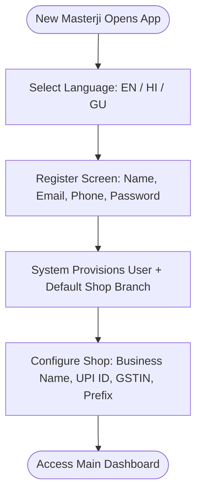
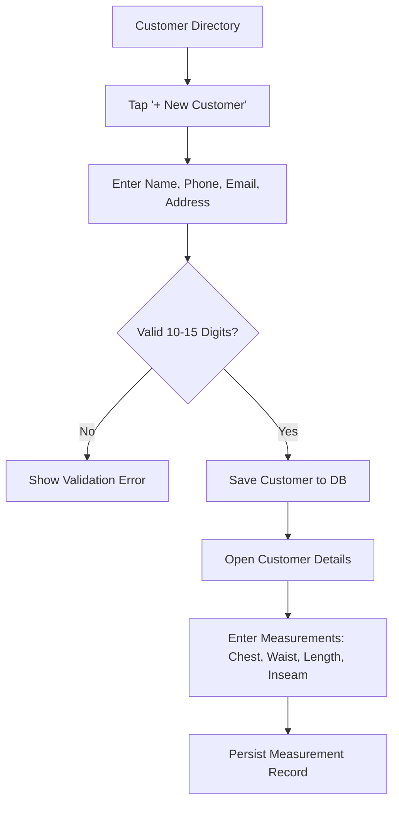
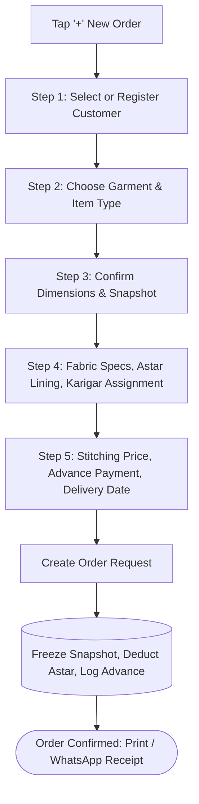
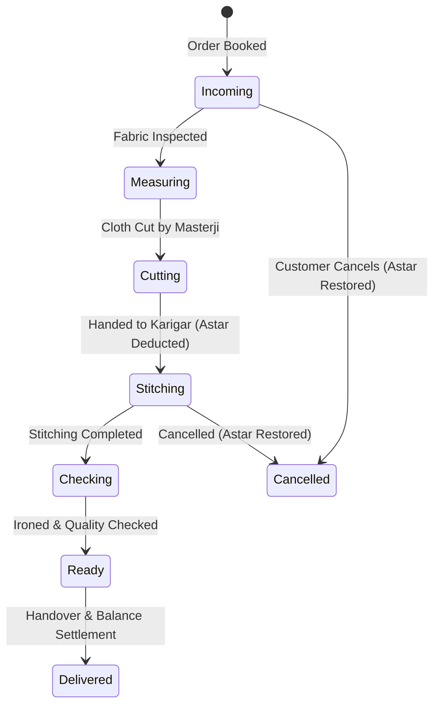
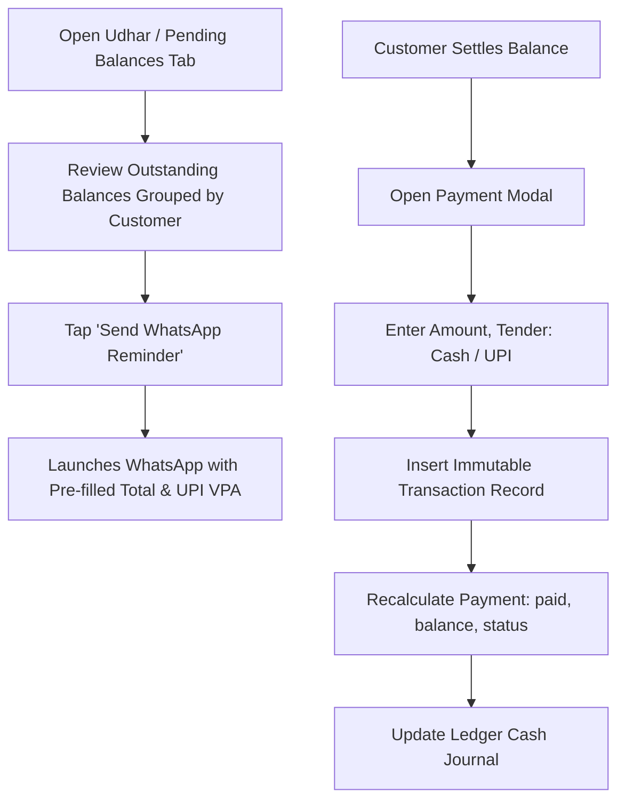
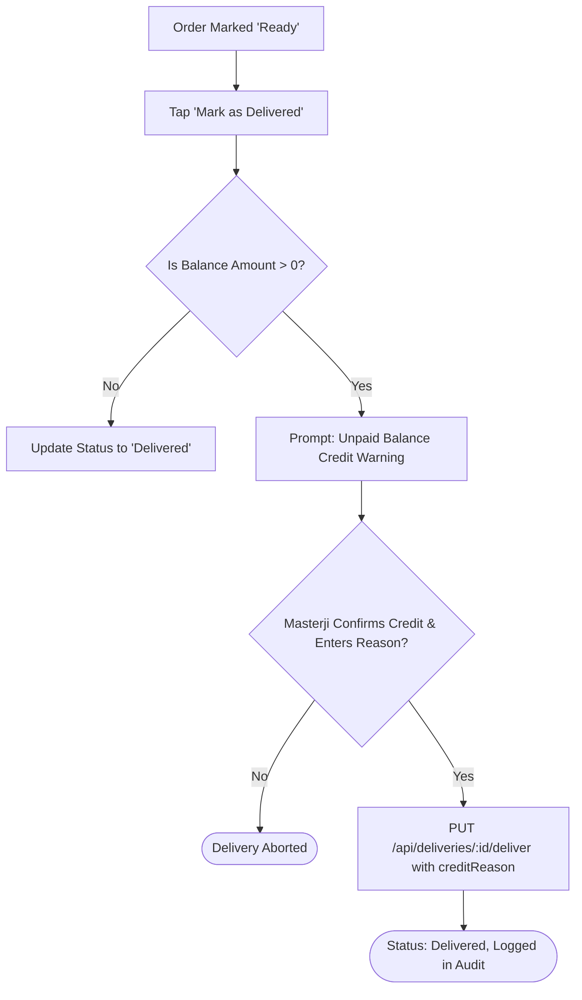
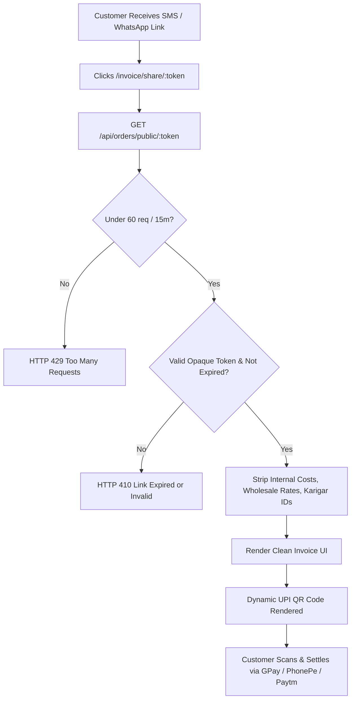

# 🧭 StitchCraft — End-to-End User Journeys & Workflows

---

## 1. Overview of Evaluated Journeys

This document details the eleven core user journeys of StitchCraft from the perspective of real-world tailor shop operators. Each workflow maps user intent, sequential screen steps, decision branches, validations, API invocations, database mutations, and offline behavior.

---

## 2. Detailed User Journeys

### Journey A: New Shop Owner Onboarding & Setup



1. **Language Selection**: User opens the mobile app or web dashboard and picks preferred language (English, Gujarati, or Hindi).
2. **Registration**: Submits name, mobile phone number, email, and password.
   - *Validation*: Name >= 2 characters, valid phone format (10–15 digits), password >= 6 characters.
   - *API*: `POST /api/auth/register` (rate-limited by `authLimiter`: 10 req / 15 min).
3. **Automatic Shop Provisioning**: The backend automatically generates a default `shops` record linked to the user's ID and marks the user's role as `owner`.
4. **Branding & Shop Settings**: User opens Shop Profile (`Profile.jsx` / `ShopSettingsScreen.dart`) and configures custom invoice prefix (e.g. `SC`), shop logo, and UPI Virtual Payment Address (e.g. `masterji@okhdfcbank`).
   - *API*: `PUT /api/shops/:id`.
5. **Dashboard Access**: Land on dashboard with empty states prompting the creation of the first customer and karigar.

---

### Journey B: Customer Registration & Measurement Logging



1. **Entry Point**: Navigation to Customers menu (`/customers` on Web or Customers tab on Mobile).
2. **Contact Entry**: Masterji enters name, WhatsApp phone number, and optional address.
   - *Validation*: Phone number must be 10–15 digits.
   - *API*: `POST /api/customers` with `idempotencyKey: cust_<UUID>`.
3. **Local Offline Behavior (Mobile)**: Record is inserted immediately into local SQLite table `customers` with `sync_status = 1`. Masterji can immediately proceed without waiting for an internet handshake.
4. **Measurement Logging**: Masterji taps "Add Measurement", chooses apparel type (Shirt / Pant / Kurta), enters dimensions via numeric keypad or voice dictation (`VoiceTextField`), and optionally attaches a photo of a physical fabric sample or old pattern.
   - *API*: `POST /api/customers/:id` (updates measurement profile).

---

### Journey C: Complete Order Creation Wizard



1. **Step 1 — Customer Selection**: Search existing customer by name/phone, or tap "Quick Add" to create on the fly.
2. **Step 2 — Garment Selection**: Choose apparel category (Shirt, Trouser, Kurta Pajama, Suit, Sherwani).
3. **Step 3 — Measurement Snapshotting**: Previous customer measurements are pre-populated with a 1-tap "Use Last Measurements" button. Masterji adjusts dimensions for this specific garment.
   - *Critical Business Rule*: The backend takes a permanent snapshot of these dimensions in `order.measurementsSnapshot`.
4. **Step 4 — Material & Assignment**: Enter fabric description, toggle whether internal lining (*astar*) is required, and optionally pick an assigned karigar.
5. **Step 5 — Pricing, Advance & Deadline**: Enter total stitching price (e.g. ₹1,200), advance collected (e.g. ₹500 via UPI), and committed delivery deadline.
6. **Execution**:
   - *API*: `POST /api/orders` with `Idempotency-Key: ord_<UUID>`.
   - *Database*: Inserts `orders` record, creates child `payments` record (`paidAmount: 500, balanceAmount: 700`), appends `transactions` entry, and creates `ledger_entries` income record.
7. **Customer Receipt**: Mobile and Web present a one-tap button: "Share Receipt on WhatsApp", generating a `wa.me` link with order confirmation and balance due.

---

### Journey D: Order Production & Stage Machine



1. **Stage Transitions**: Masterji or shop manager views active orders in Kanban cards or table view (`/orders`).
2. **Active Stitching Transition**: Moving order from `Cutting` to `Stitching` triggers material consumption:
   - *Backend Logic*: Checks if `order.astarRequired == true` and `order.astarDeducted == false`.
   - *Mutation*: Automatically decrements quantity from matching `inventory` collection item and sets `order.astarDeducted = true`.
3. **Cancellation Safety**: If the customer cancels after material allocation, moving order to `Cancelled` automatically adds back the consumed astar quantity to active inventory.
4. **Audit Trail**: Every status transition automatically creates a timestamped record in `action_logs`.

---

### Journey E: Payment Collection & Udhar Recovery



1. **Review Receivables**: Masterji navigates to the "Pending Balances" tab under `/ledger` (Web) or Khata (Mobile).
2. **Aggregated View**: Customers are sorted by total outstanding balance. Orders are aggregated: e.g., *"Ramesh Bhai — 2 orders — ₹1,400 Total Due"*.
3. **One-Tap WhatsApp Reminder**: Masterji taps the WhatsApp icon next to the customer. The app launches `https://wa.me/<phone>?text=...` with a polite Gujarati/Hindi/English reminder containing shop name, total balance due, and UPI payment ID.
4. **Recording Settlement**: When payment arrives, masterji clicks "Record Payment" on the order details screen:
   - *API*: `POST /api/orders/:id/payments`.
   - *Mutation*: Creates immutable `Transaction` record; updates `Payment.paidAmount` and `Payment.balanceAmount`; appends `LedgerEntry` income record.

---

### Journey F: Delivery Verification with Outstanding Credit Handover



1. **Handover Attempt**: Customer arrives at shop to pick up stitched garment. Staff taps "Deliver".
2. **Balance Check**:
   - If balance is ₹0: Order delivery completes immediately.
   - If balance is > ₹0 (e.g. ₹500 unpaid): System intercepts the action and displays the **Credit Delivery Confirmation Modal**.
3. **Credit Confirmation**: The masterji must explicitly check *"I confirm delivering this order on credit (Udhar)"* and enter a short reason (e.g. *"Known customer, will pay tomorrow via UPI"*).
4. **Backend Enforcement**: `controllers/deliveryController.js:45-55` rejects the delivery request with HTTP 400 if an unpaid order lacks `creditConfirmed: true` or has an empty `creditReason`.

---

### Journey G: Customer Guest Public Invoice View



1. **Receipt Delivery**: Customer receives WhatsApp link: `https://stitchcraft.app/invoice/share/sc_tok_9f8a...`
2. **Zero Login Friction**: The page opens instantly in any mobile browser without requiring a password or app installation.
3. **Data Privacy**: The backend controller (`orderController.js:180-230`) strictly filters the response:
   - *Included*: Garment type, customer name, delivery date, total price, advance paid, balance due, shop name, shop phone, shop address, shop GSTIN, UPI QR code.
   - *Excluded*: Customer phone number, address, measurement details, fabric wholesale purchase price, internal profit margins, assigned karigar names.
4. **Instant Settlement**: Customer scans the dynamic UPI QR code with Google Pay, PhonePe, or Paytm, with the shop's UPI ID and exact balance pre-filled.

---

### Journey H: Offline Operation & Multi-Day Background Sync

```mermaid
sequenceDiagram
    autonumber
    actor Tailor as Masterji (No Internet in Basement Workshop)
    participant UI as Flutter Mobile App
    participant SQLite as Encrypted Local SQLite
    participant Outbox as mutation_outbox Table
    participant Sync as SyncService / Workmanager
    participant Cloud as Supabase / Render API

    Tailor->>UI: Books 3 orders, adds 2 customers, records ₹1,500 advance
    UI->>SQLite: Writes to local tables (sync_status = 1)
    UI->>Outbox: Queues mutations with unique idempotency_keys
    Note over Tailor,SQLite: 100% functional offline; no blocked screens

    Note over Tailor: Evening: Masterji leaves shop, connects to 4G/Home Wi-Fi
    Sync->>Sync: Background Workmanager wakes up
    Sync->>Outbox: Read pending mutations
    Sync->>Cloud: POST /api/orders (Processes outbox sequentially)
    Cloud-->>Sync: HTTP 201 Created
    Sync->>Outbox: markMutationSuccess()
    Sync->>Cloud: GET /api/orders (Pull server updates)
    Cloud-->>Sync: Remote changes
    Sync->>SQLite: Upsert remote data (sync_status = 0)
    Sync->>UI: Signals DatabaseService streams -> UI refreshes badge to 'Up to date'
```

1. **Full Offline Autonomy**: Masterji books orders, measures clients, and records cash advances while completely disconnected.
2. **Durable Outbox**: Mutations are recorded in `mutation_outbox` with per-operation `idempotency_key` values.
3. **Automatic Reconnection Sync**: When network connectivity returns, `SyncService` drains the outbox queue, retries any transient failures with exponential backoff, and pulls remote cloud changes without deleting local un-synced data.

